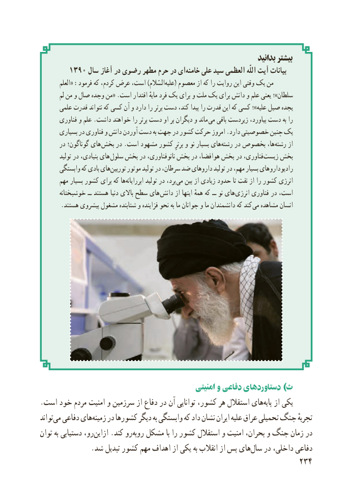

# PDF page 242

بدانید بیشتر
       1390 سال آغاز در رضوی مطهر حرم در ایخامنه‌    علی سید العظمی اللّٰه آیت بیانات
         العلم« :فرمود که کردم، عرض است، )السّالم‌علیه( معصوم از که را روایت این وقتی یک من
        لم من و صال وجده من« .است اقتدار مایهٔ فرد یک برای و ملت یک برای دانش و علم یعنی ؛»سلطان
      علمی قدرت نتواند که کسی آن و دارد را برتر دست کند، پیدا را قدرت این که کسی ؛»علیه صیل یجده
       فناوری و علم .داشت خواهند را برتر دست او بر دیگران و ماند می باقی زیردست بیاورد، دست به را
      بسیاری در فناوری و دانش آوردن دست به جهت در کشور حرکت امروز .دارد خصوصیتی چنین یک
       در گوناگون؛ های بخش در .است مشهود کشور برترِ و نو بسیار های ‌رشته در بخصوص ها،رشته‌     از
        تولید در بنیادی، های  سلول بخش در نانوفناوری، بخش در هوافضا، بخش در فناوری، ‌زیست بخش
       وابستگی که بادی هایتوربین‌     موتور تولید در سرطان، ضد داروهای تولید در مهم، بسیار رادیوداروهای
       مهم بسیار کشور برای که ها‌ابررایانه تولید در برد،  می بین از زیادی حدود تا نفت از را کشور انرژی
       خوشبختانه ــ هستند دنیا باالی سطح های  دانش از اینها همهٔ که ــ نو های  انرژی فناوری در است،
. هستند پیشروی مشغول شتابنده و فزاینده نحو به ما جوانان و ما دانشمندان که کند می مشاهده انسان

                                                امنیتی و دفاعی دستاوردهای )ث
.است خود مردم امنیت و سرزمین از دفاع در آن توانایی کشور، هر استقالل هایپایه‌   از یکی
تواندمی‌  دفاعی هایزمینه‌    در کشورها دیگر به وابستگی که داد نشان ایران علیه عراق تحمیلی جنگ تجربهٔ
توان به دستیابی رو، ‌ازاین .کند رو‌روبه مشکل با را کشور استقالل و امنیت بحران، و جنگ زمان در
 .‌شد تبدیل کشور مهم اهداف از یکی به انقالب از پس هایسال در داخلی، دفاعی
                                                          234

