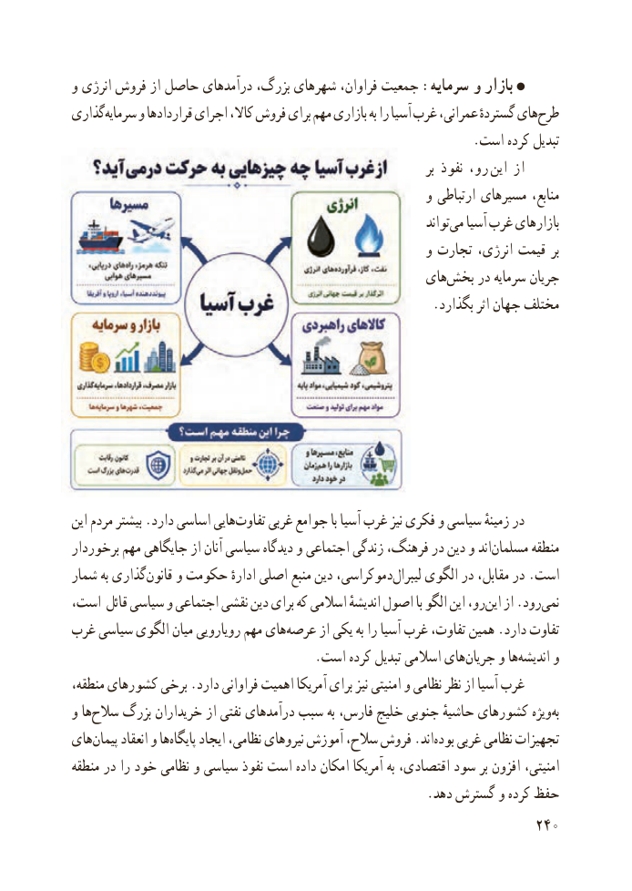

# PDF page 248

و انرژی فروش از حاصل درآمدهای بزرگ، شهرهای فراوان، جمعیت :سرمایه و بازار
گذاریسرمایه‌     و قراردادها اجرای کاال، فروش برای مهم بازاری به را آسیا غرب عمرانی، گستردهٔ هایطرح‌
                                                               .است کرده تبدیل
                                                                                    بر نفوذ رو،  این از
                                                        و ارتباطی مسیرهای منابع،
                                                                           تواندمی‌   آسیا غرب بازارهای
                                                        و تجارت انرژی، قیمت بر
                                                  های‌بخش در سرمایه جریان
                                                         .بگذارد اثر جهان مختلف

این مردم بیشتر .دارد اساسی هایی‌تفاوت غربی جوامع با آسیا غرب نیز فکری و سیاسی زمینهٔ در
برخوردار مهم جایگاهی از آنان سیاسی دیدگاه و اجتماعی زندگی فرهنگ، در دین و اند‌مسلمان منطقه
شمار به گذاری‌قانون و حکومت ادارهٔ اصلی منبع دین دموکراسی،‌لیبرال الگوی در مقابل، در .است
است، ‌ قائل سیاسی و اجتماعی نقشی دین برای که اسالمی اندیشهٔ اصول با الگو این رو،این‌   از .رودنمی‌
غرب سیاسی الگوی میان رویارویی مهم های ‌عرصه از یکی به را آسیا غرب تفاوت، همین .دارد تفاوت
   .‌است کرده تبدیل اسالمی هایجریان و هااندیشه‌     و
منطقه، کشورهای برخی .دارد فراوانی اهمیت آمریکا برای نیز امنیتی و نظامی نظر از آسیا غرب
و ها‌سالح بزرگ خریداران از نفتی درآمدهای سبب به فارس، خلیج جنوبی حاشیهٔ کشورهای ویژه ‌به
های ‌پیمان انعقاد و ها ‌پایگاه ایجاد نظامی، نیروهای آموزش سالح، فروش .اند ‌بوده غربی نظامی تجهیزات
منطقه در را خود نظامی و سیاسی نفوذ است داده امکان آمریکا به اقتصادی، سود بر افزون امنیتی،
                                                        .دهد گسترش و کرده حفظ
                                                          240

