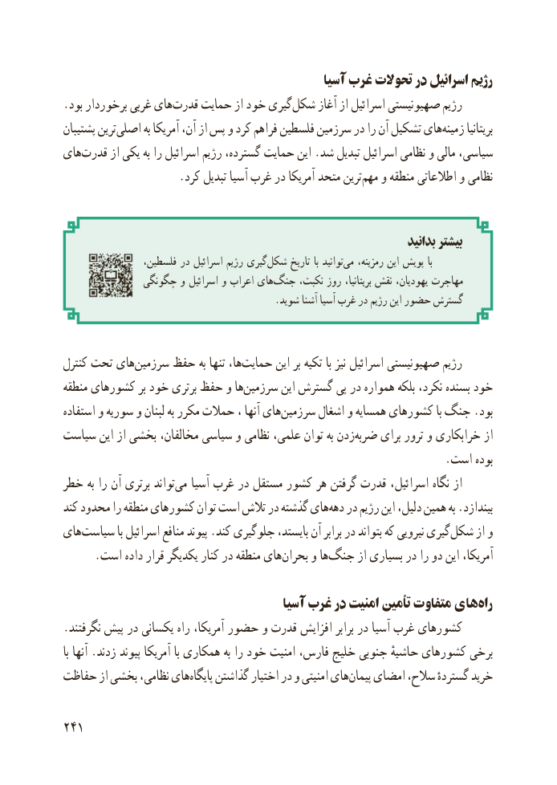

# PDF page 249

آسیا غرب تحوالت در اسرائیل رژیم
.بود برخوردار غربی های ‌قدرت حمایت از خود گیری‌شکل آغاز از اسرائیل صهیونیستی رژیم
پشتیبان ترین ‌اصلی به آمریکا آن، از پس و کرد فراهم فلسطین سرزمین در را آن تشکیل هایزمینه‌      بریتانیا
های‌قدرت از یکی به را اسرائیل رژیم گسترده، حمایت این .شد تبدیل اسرائیل نظامی و مالی سیاسی،
 .‌کرد تبدیل آسیا غرب در آمریکا متحد ترینمهم و منطقه اطالعاتی و نظامی

                                                                          بدانید بیشتر
                 فلسطین، در اسرائیل رژیم گیریشکل‌     تاریخ با توانید‌می رمزینه، این پویش با
              چگونگی و اسرائیل و اعراب های‌جنگ نکبت، روز بریتانیا، نقش یهودیان، مهاجرت
                                            .شوید آشنا آسیا غرب در رژیم این حضور گسترش

کنترل تحت های‌سرزمین حفظ به تنها ها،حمایت‌       این بر تکیه با نیز اسرائیل صهیونیستی رژیم
منطقه کشورهای بر خود برتری حفظ و هاسرزمین‌       این گسترش پی در همواره بلکه نکرد، بسنده خود
استفاده و سوریه و لبنان به مکرر حمالت ، آنها هایسرزمین‌       اشغال و همسایه کشورهای با جنگ .بود
سیاست این از بخشی مخالفان، سیاسی و نظامی علمی، توان به زدن‌ضربه برای ترور و خرابکاری از
                                                                    .است بوده
خطر به را آن برتری تواند‌می آسیا غرب در مستقل کشور هر گرفتن قدرت اسرائیل، نگاه از
کند محدود را منطقه کشورهای توان است تالش در گذشته هایدهه‌   در رژیم این دلیل، همین به .بیندازد
های ‌سیاست با اسرائیل منافع پیوند .کند جلوگیری بایستد، آن برابر در بتواند که نیرویی گیری ‌شکل از و
.‌است داده قرار یکدیگر کنار در منطقه هایبحران و هاجنگ‌      از بسیاری در را دو این آمریکا،

                                         آسیا غرب در امنیت تأمین متفاوت های‌راه
.نگرفتند پیش در یکسانی راه آمریکا، حضور و قدرت افزایش برابر در آسیا غرب کشورهای
با آنها .زدند پیوند آمریکا با همکاری به را خود امنیت فارس، خلیج جنوبی حاشیهٔ کشورهای برخی
حفاظت از بخشی نظامی، هایپایگاه‌    گذاشتن اختیار در و امنیتی هایپیمان‌   امضای سالح، گستردهٔ خرید

241

