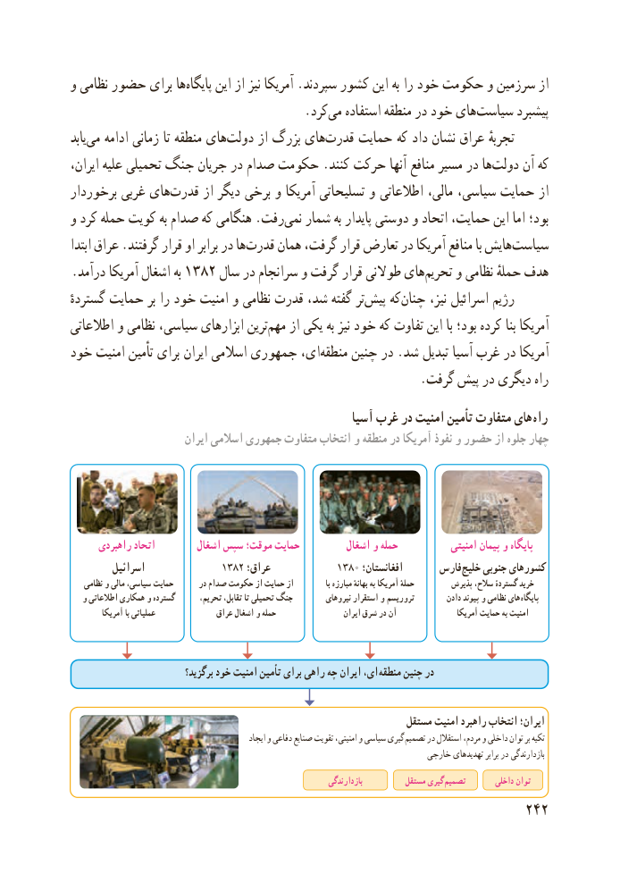

# PDF page 250

و نظامی حضور برای هاپایگاه‌     این از نیز آمریکا .سپردند کشور این به را خود حکومت و سرزمین از
                 .‌کرد می استفاده منطقه در خود هایسیاست‌       پیشبرد
یابد ‌می ادامه زمانی تا منطقه های‌دولت از بزرگ های ‌قدرت حمایت که داد نشان عراق تجربهٔ
ایران، علیه تحمیلی جنگ جریان در صدام حکومت .کنند حرکت آنها منافع مسیر در ها‌دولت آن که
برخوردار غربی های ‌قدرت از دیگر برخی و آمریکا تسلیحاتی و اطالعاتی مالی، سیاسی، حمایت از
و کرد حمله کویت به صدام که هنگامی .رفت ‌نمی شمار به پایدار دوستی و اتحاد حمایت، این اما بود؛
ابتدا عراق .گرفتند قرار او برابر در هاقدرت‌     همان گرفت، قرار تعارض در آمریکا منافع با هایش‌سیاست
.درآمد آمریکا اشغال به ۱۳۸۲ سال در سرانجام و گرفت قرار طوالنی هایتحریم‌    و نظامی حملهٔ هدف
گستردهٔ حمایت بر را خود امنیت و نظامی قدرت شد، گفته تر ‌پیش که‌چنان نیز، اسرائیل رژیم
اطالعاتی و نظامی سیاسی، ابزارهای ترینمهم‌    از یکی به نیز خود که تفاوت این با بود؛ کرده بنا آمریکا
خود امنیت تأمین برای ایران اسالمی جمهوری ای،منطقه‌    چنین در .شد تبدیل آسیا غرب در آمریکا
                                                        .گرفت پیش در دیگری راه
                                                     آسیا غرب در امنیت تإمین متفاوت های راه
                        ایران اسالمی جمهوری متفاوت انتخاب و منطقه در آمریکا نفوذ و حضور از جلوه چهار

      راهبردی اتحاد         اشغال سپس موقت؛ حمایت          اشغال و حمله            امنیتی پیمان و پایگاه
         اسرائیل              1382 عراق؛            1380 افغانستان؛       فارس خلیج جنوبی کشورهای
    نظامی و مالی ،سیاسی حمایت       در صدام حکومت از حمایت از              با مبارزه بهانهٴ به آمریکا حملهٴ         پذیرش ،سالح گستردهٴ خرید
   و اطالعاتی همکاری و گسترده       ،تحریم ،تقابل تا تحمیلی جنگ         نیروهای استقرار و تروریسم         دادن پیوند و نظامی های  پایگاه
         آمریکا با عملیاتی               عراق اشغال و حمله                    ایران شرق در آن                 آمریکا حمایت به امنیت

                             برگزید؟ خود امنیت تأمین برای راهی چه ایران ،ای منطقه چنین در

                                                                  مستقل امنیت راهبرد انتخاب ایران؛
                                                     ایجاد و دفاعی صنایع تقویت امنیتی، و سیاسی گیری تصمیم در استقالل مردم، و داخلی توان بر تکیه
                                                                           خارجی تهدیدهای برابر در بازدارندگی
                                                                           بازدارندگی          مستقل گیری تصمیم        داخلی توان
                                                          242

