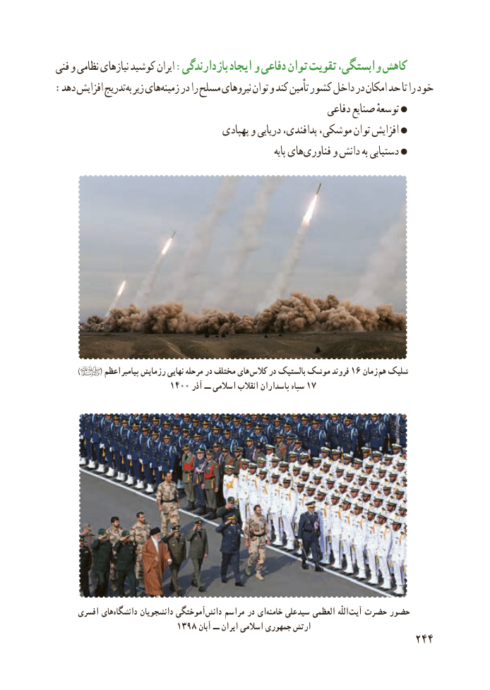

# PDF page 252

فنی و نظامی نیازهای کوشید ایران :بازدارندگی ایجاد و دفاعی توان تقویت ،وابستگی کاهش
: دهد افزایش تدریجبه زیر هایزمینه‌    در را مسلح نیروهای توان و کند تأمین کشور داخل در امکان حد تا را خود
                                                          دفاعی صنایع توسعهٔ
                                      پهپادی و دریایی پدافندی، موشکی، توان افزایش
                                                                           پایه هایفناوری‌     و دانش به دستیابی

         )        ( اعظم  پیامبر رزمایش نهایی مرحله در مختلف های کالس در بالستیک موشک فروند ۱۶ زمان هم شلیک
                       1400 آذر ــ اسالمی انقالب پاسداران سپاه ۱۷

     افسری هایدانشگاه‌       دانشجویان آموختگی‌دانش مراسم در ایخامنه‌    علی  سید العظمی  اللّٰه  آیت حضرت حضور
                         1398 آبان ــ ایران اسالمی جمهوری ارتش
                                                          244

