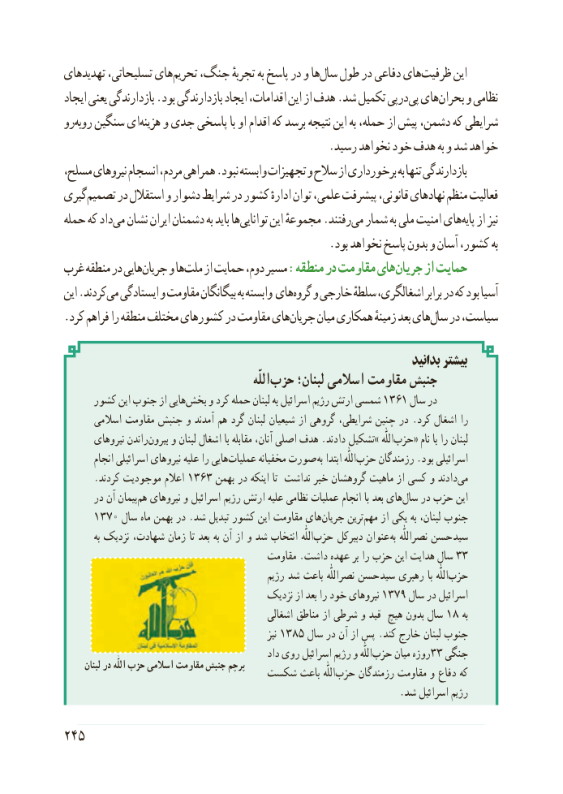

# PDF page 253

تهدیدهای تسلیحاتی، هایتحریم‌   جنگ، تجربهٔ به پاسخ در و هاسال‌   طول در دفاعی هایظرفیت‌      این
ایجاد یعنی بازدارندگی .بود بازدارندگی ایجاد اقدامات، این از هدف .شد تکمیل درپیپی‌ هایبحران‌    و نظامی
روروبه‌   سنگین ایهزینه‌    و جدی پاسخی با او اقدام که برسد نتیجه این به حمله، از پیش دشمن، که شرایطی
                                               .رسید نخواهد خود هدف به و شد خواهد
مسلح، نیروهای انسجام مردم، همراهی .نبود وابسته تجهیزات و سالح از برخورداری به تنها بازدارندگی
گیریتصمیم‌     در استقالل و دشوار شرایط در کشور ادارهٔ توان علمی، پیشرفت قانونی، نهادهای منظم فعالیت
حمله که دادمی‌  نشان ایران دشمنان به باید هاتوانایی‌      این مجموعهٔ .رفتندمی‌  شمار به ملی امنیت هایپایه‌   از نیز
                                               .بود نخواهد پاسخ بدون و آسان کشور، به
غرب منطقه در هاییجریان‌    و هاملت‌    از حمایت دوم، مسیر :منطقه در مقاومت هایجریان‌     از حمایت
این .کردندمی‌  ایستادگی و مقاومت بیگانگان به وابسته هایگروه‌   و خارجی سلطهٔ اشغالگری، برابر در که بود آسیا
.کرد فراهم را منطقه مختلف کشورهای در مقاومت هایجریان‌     میان همکاری زمینهٔ بعد هایسال‌   در سیاست،

                                                                          بدانید بیشتر
                                                                  اللّٰهحزب‌     لبنان؛ اسالمی مقاومت جنبش
     کشور این جنوب از هاییبخش۱۳۶۱‌    و کرد حمله لبنان به اسرائیل رژیم ارتش شمسی      سال در
       اسالمی مقاومت جنبش و آمدند هم گرد لبنان شیعیان از گروهی شرایطی، چنین در .کرد اشغال را
       نیروهای راندنبیرون‌    و لبنان اشغال با مقابله آنان، اصلی هدف .دادند تشکیل» اللّٰه‌حزب« نام با را لبنان
        انجام اسرائیلی نیروهای علیه را هایی ‌عملیات مخفیانه صورت به ابتدا اللّٰه‌حزب رزمندگان .بود اسرائیلی
      .کردند موجودیت اعالم 1363 بهمن در اینکه تا نداشت خبر گروهشان ماهیت از کسی و دادند‌می
      در آن پیمانهم‌  نیروهای و اسرائیل رژیم ارتش علیه نظامی عملیات انجام با بعد های‌سال در حزب این
     1370 سال ماه بهمن در .شد تبدیل کشور این مقاومت های‌جریان ترین‌مهم از یکی به لبنان، جنوب
          به نزدیک شهادت، زمان تا بعد به آن از و شد انتخاب  اللّٰه‌حزب دبیرکل عنوان به نصراللّٰه حسن سید
                                          مقاومت .داشت عهده بر را حزب این هدایت سال 33
                                               رژیم شد باعث نصراللّٰه حسن سید رهبری با  اللّٰه ‌حزب
                                        نزدیک از بعد را خود نیروهای ۱۳۷۹ سال در اسرائیل
                                               اشغالی مناطق از شرطی و قید هیچ بدون سال 18 به
                                                                نیز ۱۳۸۵ سال در آن از پس .کند خارج لبنان جنوب
                                                  داد روی اسرائیل رژیم و اللّٰه‌حزب۳۳میان روزه  جنگی
      لبنان در اللّٰه حزب اسالمی مقاومت جنبش پرچم                            شکست باعث  اللّٰه‌حزب رزمندگان مقاومت و دفاع که
                                                                     .شد اسرائیل رژیم

245

