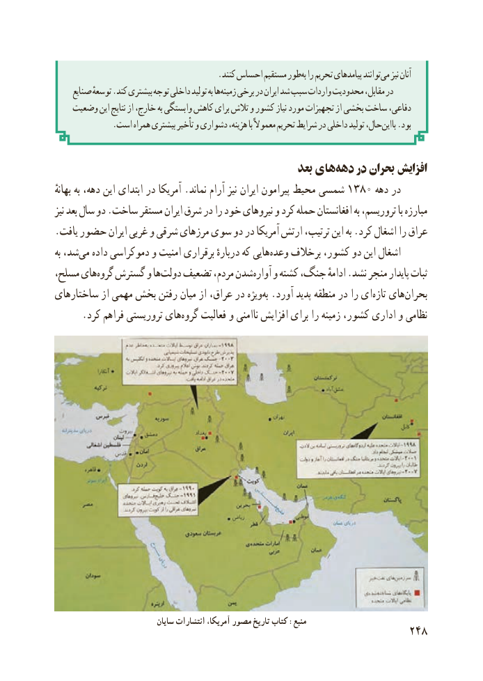

# PDF page 256

.کنند احساس مستقیم طوربه‌ را تحریم پیامدهای توانندمی‌   نیز آنان
     صنایع توسعهٔ .کند بیشتری توجه داخلی تولید به هازمینه‌   برخی در ایران شد سبب واردات محدودیت مقابل، در
   وضعیت این نتایج از خارج، به وابستگی کاهش برای تالش و کشور نیاز مورد تجهیزات از بخشی ساخت دفاعی،
.‌است همراه بیشتری تأخیر و دشواری هزینه، با معموالً تحریم شرایط در داخلی تولید حال،بااین .بود

                                                  بعد های‌دهه در بحران افزایش
بهانهٔ به دهه، این ابتدای در آمریکا .نماند آرام نیز ایران پیرامون محیط شمسی 1380 دهه در
نیز بعد سال دو .ساخت مستقر ایران شرق در را خود نیروهای و کرد حمله افغانستان به تروریسم، با مبارزه
.یافت حضور ایران غربی و شرقی مرزهای سوی دو در آمریکا ارتش ترتیب، این به .کرد اشغال را عراق
به شد،می‌   داده دموکراسی و امنیت برقراری دربارهٔ که هایی‌وعده برخالف کشور، دو این اشغال
مسلح، هایگروه‌   گسترش و هادولت‌   تضعیف مردم، شدنآواره‌    و کشته جنگ، ادامهٔ .نشد منجر پایدار ثبات
ساختارهای از مهمی بخش رفتن میان از عراق، در ویژه ‌به .آورد پدید منطقه در را ای‌تازه های‌بحران
 .‌کرد فراهم تروریستی هایگروه فعالیت و ناامنی افزایش برای را زمینه کشور، اداری و نظامی

                              سایان انتشارات ،آمریکا مصور تاریخ کتاب :منبع
                                                          248

