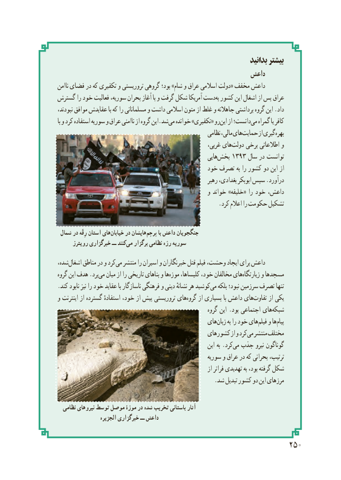

# PDF page 258

بدانید بیشتر
                                                    داعش
ناامن فضای در که تکفیری و تروریستی گروهی بود؛ »شام و عراق اسالمی دولت« مخفف داعش
گسترش را خود فعالیت سوریه، بحران آغاز با و گرفت شکل آمریکا دستبه‌ کشور این اشغال از پس عراق
نبودند، موافق عقایدش با که را مسلمانانی و داشت اسالمی متون از غلط و جاهالنه برداشتی گروه این .داد
با و کرد استفاده سوریه و عراق ناامنی از گروه این.شدمی‌  خوانده »تکفیری« رواین‌   از دانست؛می‌  گمراه یا کافر
                                                         نظامی مالی، هایحمایت‌      از گیریبهره‌
                                                         غربی، هایدولت‌    برخی اطالعاتی و
                                                            هاییبخش۱۳۹۳‌         سال در توانست
                                            خود تصرف به را کشور دو این از
                                                           رهبر بغدادی، ابوبکر سپس .درآورد
                                                   و خواند »خلیفه« را خود داعش،
                                                       .کرد اعالم را حکومت تشکیل

 شمال در رِقّه استان هایخیابان‌     در هایشانپرچم‌       با داعش جنگجویان
      رویترز خبرگزاری ــ کنندمی‌   برگزار نظامی رژه سوریه
شده،اشغال‌     مناطق در و کردمی‌  منتشر را اسیران و خبرنگاران قتل فیلم وحشت، ایجاد برای داعش
گروه این هدف .بردمی‌  میان از را تاریخی بناهای و هاموزه‌    کلیساها، خود، مخالفان هایزیارتگاه‌      و مسجدها
.کند نابود نیز را خود عقاید با ناسازگار فرهنگی و دینی نشانهٔ هر کوشیدمی‌   بلکه نبود؛ سرزمین تصرف تنها
و اینترنت از گسترده استفادهٔ خود، از پیش تروریستی هایگروه‌    از بسیاری با داعش هایتفاوت‌      از یکی
                                                            گروه این .بود اجتماعی هایشبکه‌
                                               هایزبان‌     به را خود هایفیلم‌   و هاپیام‌
                                              کشورهای از و کردمی‌  منتشر مختلف
                                                               این به .کردمی‌  جذب نیرو گوناگون
                                                      سوریه و عراق در که بحرانی ترتیب،
                                                                  از فراتر تهدیدی به بود، گرفته شکل
                                                     .شد تبدیل کشور دو این مرزهای

  نظامی نیروهای توسط موصل موزۀ در شده تخریب باستانی آثار
                   الجزیره خبرگزاری ــ داعش

                                                     250

