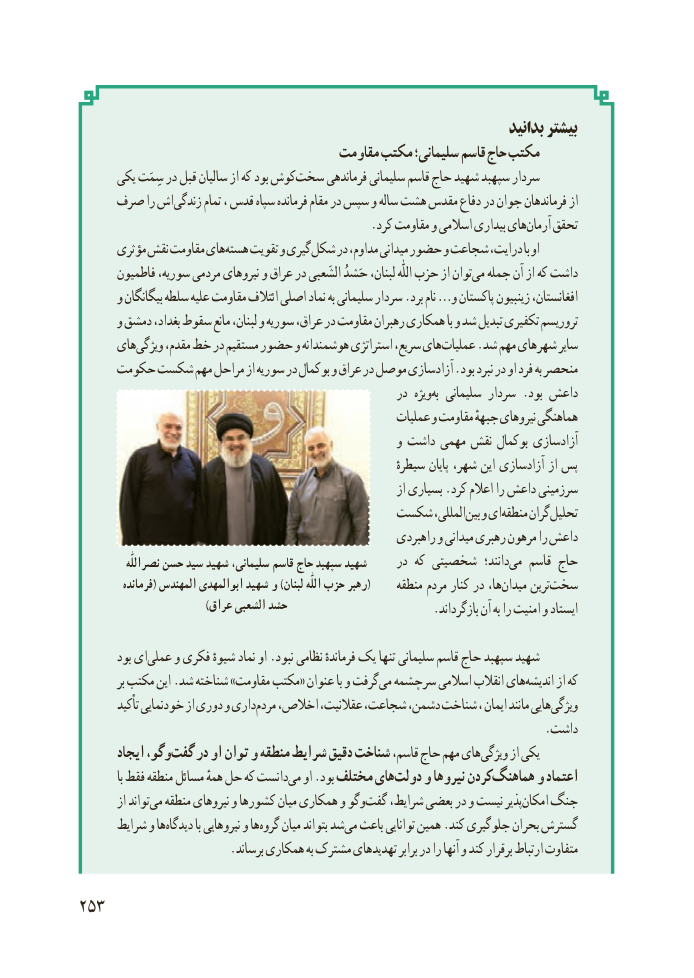

# PDF page 261

بدانید بیشتر
                                       مقاومت مکتب سلیمانی؛ قاسم حاج مکتب
      یکی سِمَت در قبل سالیان از که بود کوشسخت‌     فرماندهی سلیمانی قاسم حاج شهید سپهبد سردار
    صرف را اشزندگی‌      تمام ، قدس سپاه فرمانده مقام در سپس و ساله هشت مقدس دفاع در جوان فرماندهان از
                                                 .کرد مقاومت و اسالمی بیداری هایآرمان‌    تحقق
      مؤثری نقش مقاومت هایهسته‌    تقویت و گیریشکل‌    در مداوم، میدانی حضور و شجاعت درایت، با او
       فاطمیون سوریه، مردمی نیروهای و عراق در الشَعبی حَشدُ لبنان، اللّٰه حزب از توانمی‌  جمله آن از که داشت
      و بیگانگان سلطه علیه مقاومت ائتالف اصلی نماد به سلیمانی سردار .برد نام …و پاکستان زینبیون افغانستان،
      و دمشق بغداد، سقوط مانع لبنان، و سوریه عراق، در مقاومت رهبران همکاری با و شد تبدیل تکفیری تروریسم
      هایویژگی‌     مقدم، خط در مستقیم حضور و هوشمندانه استراتژی سریع، هایعملیات‌     .شد مهم شهرهای سایر
     حکومت شکست مهم مراحل از سوریه در بوکمال و عراق در موصل آزادسازی .بود نبرد در او فرد به منحصر
                                                        در ویژهبه‌  سلیمانی سردار .بود داعش
                                                        عملیات و مقاومت جبههٔ نیروهای هماهنگی
                                                     و داشت مهمی نقش بوکمال آزادسازی
                                                                  سیطرهٔ پایان شهر، این آزادسازی از پس
                                                                    از بسیاری .کرد اعالم را داعش سرزمینی
                                   شکست المللی،بین‌  و ایمنطقه‌    گرانتحلیل‌
                                                         راهبردی و میدانی رهبری مرهون را داعش
             نصراللّٰه حسن سید شهید ،سلیمانی قاسم حاج سپهبد شهید     در که شخصیتی  دانند؛می‌   قاسم حاج
          فرمانده( المهندس ابوالمهدی شهید و )لبنان اللّٰه حزب رهبر(     منطقه مردم کنار در ها،میدان‌     ترینسخت‌
                                     )عراق الشعبی حشد                        .بازگرداند آن به را امنیت و ایستاد

        بود ایعملی‌    و فکری شیوهٔ نماد او .نبود نظامی فرماندهٔ یک تنها سلیمانی قاسم حاج سپهبد شهید
          بر مکتب این .شد شناخته »مقاومت مکتب« عنوان با و گرفتمی‌  سرچشمه اسالمی انقالب هایاندیشه‌      از که
         تأکید خودنمایی از دوری و داریمردم‌   اخالص، عقالنیت، شجاعت، دشمن، شناخت ، ایمان مانند هاییویژگی‌
                                                                              .داشت
       ایجاد ،گفتوگو‌   در او توان و منطقه شرایط دقیق شناخت قاسم، حاج مهم هایویژگی‌      از یکی
            با فقط منطقه مسائل همهٔ حل که دانستمی‌   او .بود مختلف هایدولت‌   و نیروها کردنهماهنگ‌     و اعتماد
        از تواندمی‌  منطقه نیروهای و کشورها میان همکاری و وگوگفت‌    شرایط، بعضی در و نیست پذیرامکان‌   جنگ
      شرایط و هادیدگاه‌        با نیروهایی و هاگروه‌    میان بتواند شدمی‌  باعث توانایی همین .کند جلوگیری بحران گسترش
                         .برساند همکاری به مشترک تهدیدهای برابر در را آنها و کند برقرار ارتباط متفاوت

253

