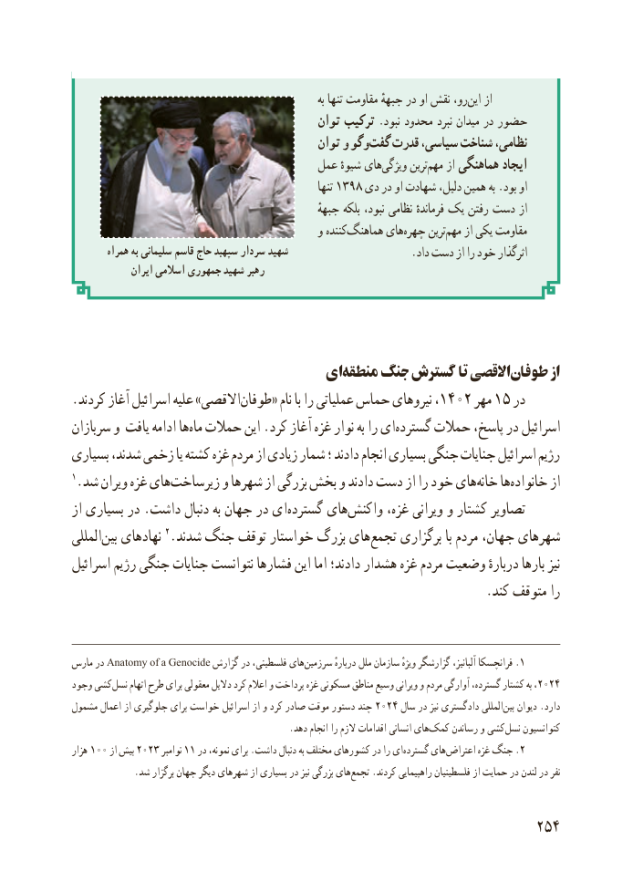

# PDF page 262

به تنها مقاومت جبههٔ در او نقش رو، این از
                                            توان ترکیب .نبود محدود نبرد میدان در حضور
                                            توان و وگوگفت‌   قدرت ،سیاسی شناخت ،نظامی
                                     عمل شیوهٔ هایویژگی‌      ترینمهم‌    از هماهنگی ایجاد
                                                                تنها ۱۳۹۸ دی در او شهادت دلیل، همین به .بود او
                                                        جبههٔ بلکه نبود، نظامی فرماندهٔ یک رفتن دست از
                                             و کنندههماهنگ‌      هایچهره‌     ترینمهم‌    از یکی مقاومت
        همراه به سلیمانی قاسم حاج سپهبد سردار شهید                      .داد دست از را خود اثرگذار
              ایران اسالمی جمهوری شهید رهبر

                              ایمنطقه‌    جنگ گسترش تا االقصیطوفان‌        از
.کردند آغاز اسرائیل علیه »االقصیطوفان۱۴۰۲‌     « نام با را عملیاتی حماس نیروهای ،     مهر۱۵ در
سربازان و یافت ادامه هاماه‌  حمالت این .کرد آغاز غزه نوار به را ای ‌گسترده حمالت پاسخ، در اسرائیل
بسیاری شدند، زخمی یا کشته غزه مردم از زیادی شمار ؛ دادند انجام بسیاری جنگی جنایات اسرائیل رژیم
1.شد ویران غزه هایزیرساخت‌        و شهرها از بزرگی بخش و دادند دست از را خود هایخانه‌    هاخانواده‌       از
از بسیاری در .داشت دنبال به جهان در ای‌گسترده های ‌واکنش غزه، ویرانی و کشتار تصاویر
المللی‌بین نهادهای 2.شدند جنگ توقف خواستار بزرگ های‌تجمع برگزاری با مردم جهان، شهرهای
اسرائیل رژیم جنگی جنایات نتوانست فشارها این اما دادند؛ هشدار غزه مردم وضعیت دربارهٔ بارها نیز
                                                                 .کند متوقف را

مارس در Anatomy of a Genocide گزارش در فلسطینی، های‌.سرزمین دربارهٔ ملل سازمان ویژهٔ گزارشگر آلبانیز، فرانچسکا 1
وجود کشی نسل۲۰۲۴‌     اتهام طرح برای معقولی دالیل کرد اعالم و پرداخت غزه مسکونی مناطق وسیع ویرانی و مردم آوارگی گسترده، کشتار به ،
مشمول۲۰۲۴اعمال از جلوگیری برای خواست اسرائیل از و کرد صادر موقت دستور چند      سال در نیز دادگستری المللی‌بین دیوان .دارد
                                                .دهد انجام را الزم اقدامات انسانی هایکمک‌     رساندن و کشینسل‌    کنوانسیون
هزار  100 از۲۰۲۳بیش      نوامبر۱۱ در نمونه، برای .داشت دنبال به مختلف کشورهای در را ای ‌گسترده های ‌.اعتراض غزه جنگ 2
              .شد برگزار جهان دیگر شهرهای از بسیاری در نیز بزرگی هایتجمع‌    .کردند راهپیمایی فلسطینیان از حمایت در لندن در نفر

                                                          254

