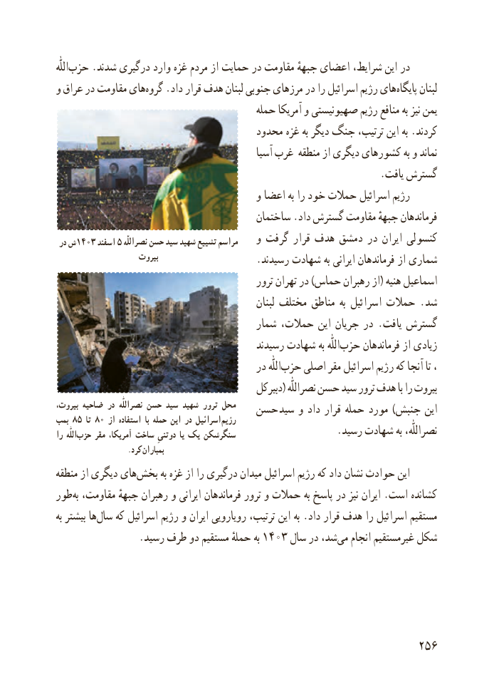

# PDF page 264

اللّٰه ‌حزب .شدند درگیری وارد غزه مردم از حمایت در مقاومت جبههٔ اعضای شرایط، این در
و عراق در مقاومت های ‌گروه .داد قرار هدف لبنان جنوبی مرزهای در را اسرائیل رژیم های ‌پایگاه لبنان
                                         حمله آمریکا و صهیونیستی رژیم منافع به نیز یمن
                                     محدود غزه به دیگر جنگ ترتیب، این به .کردند
                                                  آسیا غرب منطقه از دیگری کشورهای به و نماند
                                                                 .یافت گسترش
                                        و اعضا به را خود حمالت اسرائیل رژیم
                                         ساختمان .داد گسترش مقاومت جبههٔ فرماندهان
 در ش۱۴۰۳ اسفند ۵ نصراللّٰه حسن سید شهید تشییع مراسم    و گرفت قرار هدف دمشق در ایران کنسولی
                     بیروت                    .رسیدند شهادت به ایرانی فرماندهان از شماری
                                               ترور تهران در )حماس رهبران از( هنیه اسماعیل
                                                       لبنان مختلف مناطق به اسرائیل حمالت . شد
                                        شمار حمالت، این جریان در . یافت گسترش
                                           رسیدند شهادت به اللّٰه ‌حزب فرماندهان از زیادی
                                         در اللّٰه‌حزب اصلی مقر اسرائیل رژیم که آنجا تا ،
                                              دبیرکل( نصراللّٰه حسن سید ترور هدف با را بیروت
،بیروت ضاحیه در  نصراللّٰه حسن سید شهید ترور محل   حسن  سید و داد قرار حمله مورد ) جنبش اینبمب ۸۵ تا ۸۰ از استفاده  با حمله این در اسرائیل رژیم
را  اللّٰهحزب‌     مقر ،آمریکا ساخت ِدوتنی یا یک سنگرشکن                    .رسید شهادت به نصراللّٰه،
                    .کرد بمباران
منطقه از دیگری های ‌بخش به غزه از را درگیری میدان اسرائیل رژیم که داد نشان حوادث این
طور ‌به مقاومت، جبههٔ رهبران و ایرانی فرماندهان ترور و حمالت به پاسخ در نیز ایران .است کشانده
به بیشتر ها‌سال که اسرائیل رژیم و ایران رویارویی ترتیب، این به .داد قرار هدف را اسرائیل مستقیم
                 .رسید طرف دو مستقیم حملهٔ به ۱۴۰۳ سال در شد،می‌   انجام غیرمستقیم شکل

                                                          256

