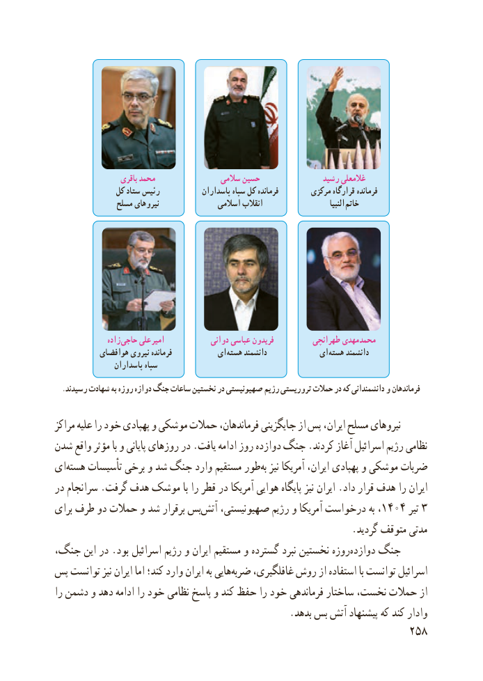

# PDF page 266

باقری محمد                سالمی حسین                رشید غالمعلی
              کل ستاد رئیس            پاسداران سپاه کل فرمانده        مرکزی قرارگاه فرمانده
                مسلح نیروهای               اسالمی انقالب                           النبیا  خاتم

                زاده حاجی علی امیر             دوانی عباسی فریدون          طهرانچی مهدی محمد
           هوافضای نیروی فرمانده           ای  هسته دانشمند            ای هسته دانشمند
                 پاسداران سپاه
  .رسیدند شهادت به روزه دوازه جنگ ساعات نخستین در صهیونیستی رژیم تروریستی حمالت در که دانشمندانی و فرماندهان

مراکز علیه را خود پهپادی و موشکی حمالت فرماندهان، جایگزینی از پس ایران، مسلح نیروهای
شدن واقع مؤثر با و پایانی روزهای در .یافت ادامه روز دوازده جنگ .کردند آغاز اسرائیل رژیم نظامی
ای ‌هسته تأسیسات برخی و شد جنگ وارد مستقیم طور‌به نیز آمریکا ایران، پهپادی و موشکی ضربات
در سرانجام .گرفت هدف موشک با را قطر در آمریکا هوایی پایگاه نیز ایران .داد قرار هدف را ایران
برای طرف دو حمالت و شد برقرار بسآتش۱۴۰۴‌   صهیونیستی، رژیم و آمریکا درخواست به ،      تیر۳
                                                             .گردید متوقف مدتی
جنگ، این در .بود اسرائیل رژیم و ایران مستقیم و گسترده نبرد نخستین روزه‌دوازده جنگ
پس توانست نیز ایران اما کند؛ وارد ایران به هایی‌ضربه غافلگیری، روش از استفاده با توانست اسرائیل
را دشمن و دهد ادامه را خود نظامی پاسخ و کند حفظ را خود فرماندهی ساختار نخست، حمالت از
                                                .بدهد بس آتش پیشنهاد که کند وادار
                                                          258

