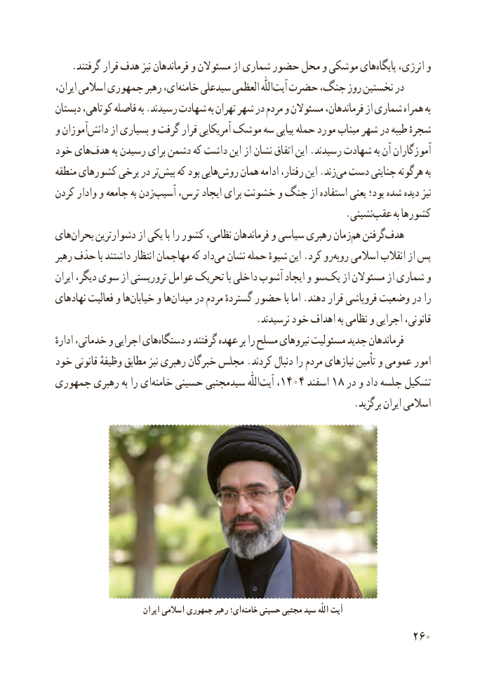

# PDF page 268

.گرفتند قرار هدف نیز فرماندهان و مسئوالن از شماری حضور محل و موشکی هایپایگاه‌    انرژی، و
ایران، اسالمی جمهوری رهبر ای،خامنه‌    سیدعلی العظمی اللّٰهآیت‌  حضرت جنگ، روز نخستین در
دبستان کوتاهی، فاصله به .رسیدند شهادت به تهران شهر در مردم و مسئوالن فرماندهان، از شماری همراه به
و آموزاندانش‌     از بسیاری و گرفت قرار آمریکایی موشک سه پیاپی حمله مورد میناب شهر در طیبه شجرهٔ
خود هایهدف‌      به رسیدن برای دشمن که داشت این از نشان اتفاق این .رسیدند شهادت به آن آموزگاران
منطقه کشورهای برخی در ترپیش‌    که بود هاییروش‌    همان ادامه رفتار، این .زندمی‌ دست جنایتی هرگونه به
کردن وادار و جامعه به زدنآسیب‌    ترس، ایجاد برای خشونت و جنگ از استفاده یعنی بود؛ شده دیده نیز
                   .‌نشینیعقب به کشورها
هایبحران‌     دشوارترین از یکی با را کشور نظامی، فرماندهان و سیاسی رهبری زمانهم‌  گرفتنهدف‌
رهبر حذف با داشتند انتظار مهاجمان که دادمی‌  نشان حمله شیوهٔ این .کرد روروبه‌   اسالمی انقالب از پس
ایران دیگر، سوی از تروریستی عوامل تحریک با داخلی آشوب ایجاد و سویک‌    از مسئوالن از شماری و
نهادهای فعالیت و هاخیابان‌     و هامیدان‌    در مردم گستردهٔ حضور با اما .دهند قرار فروپاشی وضعیت در را
                                         .نرسیدند خود اهداف به نظامی و اجرایی قانونی،
ادارهٔ خدماتی، و اجرایی هایدستگاه‌     و گرفتند عهده بر را مسلح نیروهای مسئولیت جدید فرماندهان
خود قانونی وظیفهٔ مطابق نیز رهبری خبرگان مجلس .کردند دنبال را مردم نیازهای تأمین و عمومی امور
جمهوری رهبری به را ایخامنه‌    حسینی سیدمجتبی اللّٰهآیت۱۴۰۴‌    ،     اسفند۱۸ در و داد جلسه تشکیل
                                                             .برگزید ایران اسالمی

                          ایران اسالمی جمهوری رهبر ای؛‌خامنه حسینی مجتبی سید اللّٰه آیت
                                                          260

