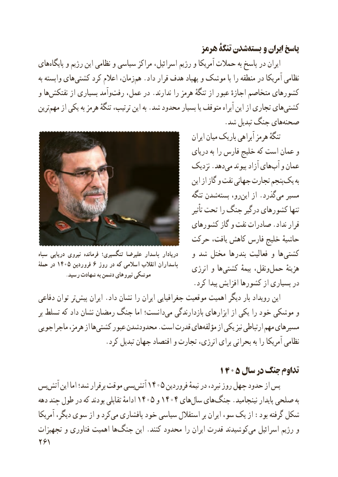

# PDF page 269

هرمز تنگۀ شدنبسته‌   و ایران پاسخ
های‌پایگاه و رژیم این نظامی و سیاسی مراکز اسرائیل، رژیم و آمریکا حمالت به پاسخ در ایران
به وابسته های‌کشتی کرد اعالم زمان،هم‌  .داد قرار هدف پهپاد و موشک با را منطقه در آمریکا نظامی
و ها‌نفتکش از بسیاری وآمدرفت‌   عمل، در .ندارند را هرمز تنگهٔ از عبور اجازهٔ متخاصم کشورهای
ترین ‌مهم از یکی به هرمز تنگهٔ ترتیب، این به .شد محدود بسیار یا متوقف آبراه این از تجاری های‌کشتی
      .‌شد تبدیل جنگ هایصحنه
                                                           ایران میان باریک آبراهی هرمز تنگهٔ
                                               دریای به را فارس خلیج که است عمان و
                                           نزدیک .دهد‌می پیوند آزاد های ‌آب و عمان
                                                       این از گاز و نفت جهانی تجارت پنجمیک‌    به
                                                        تنگه شدنبسته‌    رو،‌این از .گذرد‌می مسیر
                                                                       تأثیر تحت را جنگ درگیر کشورهای تنها
                                        کشورهای گاز و نفت صادرات .نداد قرار
                                   حرکت یافت، کاهش فارس خلیج حاشیهٔ
سپاه دریایی نیروی فرمانده تنگسیری؛ علیرضا پاسدار دریادار    و شد مختل بندرها فعالیت و ها‌کشتی
ٔحمله در 1405 فروردین 6 روز در که اسالمی انقالب پاسداران    انرژی و ها ‌کشتی بیمهٔ ونقل،‌حمل هزینهٔ           .رسید شهادت به دشمن نیروهای موشکی
                                             .کرد پیدا افزایش کشورها از بسیاری در
دفاعی توان ترپیش‌     ایران .داد نشان را ایران جغرافیایی موقعیت اهمیت دیگر بار رویداد این
بر تسلط که داد نشان رمضان جنگ اما دانست؛می‌   بازدارندگی ابزارهای از یکی را خود موشکی و
ماجراجویی هرمز، از هاکشتی‌    عبور محدودشدن .است قدرت هایمؤلفه‌     از یکی نیز ارتباطی مهم مسیرهای
                    .کرد تبدیل جهان اقتصاد و تجارت انرژی، برای بحرانی به را آمریکا نظامی

                                 ۱۴۰۵ سال در جنگ تداوم
بسآتش‌    این اما شد؛ برقرار موقت بسیآتش۱۴۰۵‌         فروردین نیمهٔ در نبرد، روز چهل حدود از پس
دهه چند طول در که بودند تقابلی ادامهٔ ۱۴۰۵ و۱۴۰۴ های‌سال های‌جنگ .نینجامید پایدار صلحی به
آمریکا دیگر، سوی از و کردمی‌  پافشاری خود سیاسی استقالل بر ایران سو، یک از :بود گرفته شکل
تجهیزات و فناوری اهمیت ها‌جنگ این .کنند محدود را ایران قدرت کوشیدندمی‌   اسرائیل رژیم و
261

