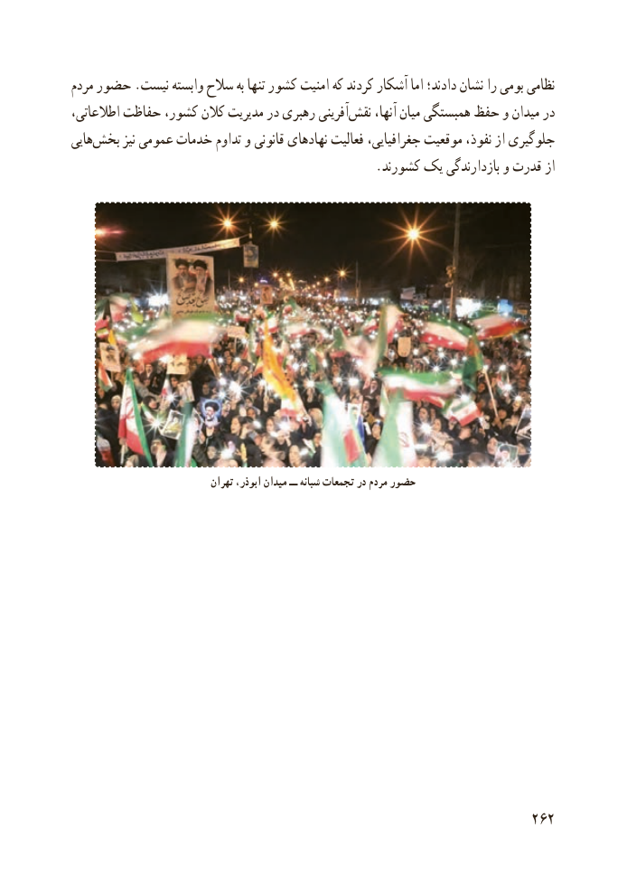

# PDF page 270

مردم حضور .نیست وابسته سالح به تنها کشور امنیت که کردند آشکار اما دادند؛ نشان را بومی نظامی
اطالعاتی، حفاظت کشور، کالن مدیریت در رهبری آفرینی ‌نقش آنها، میان همبستگی حفظ و میدان در
هایی ‌بخش نیز عمومی خدمات تداوم و قانونی نهادهای فعالیت جغرافیایی، موقعیت نفوذ، از جلوگیری
                                                .کشورند یک بازدارندگی و قدرت از

                              تهران ،ابوذر میدان ــ شبانه تجمعات در مردم حضور

                                                          262

