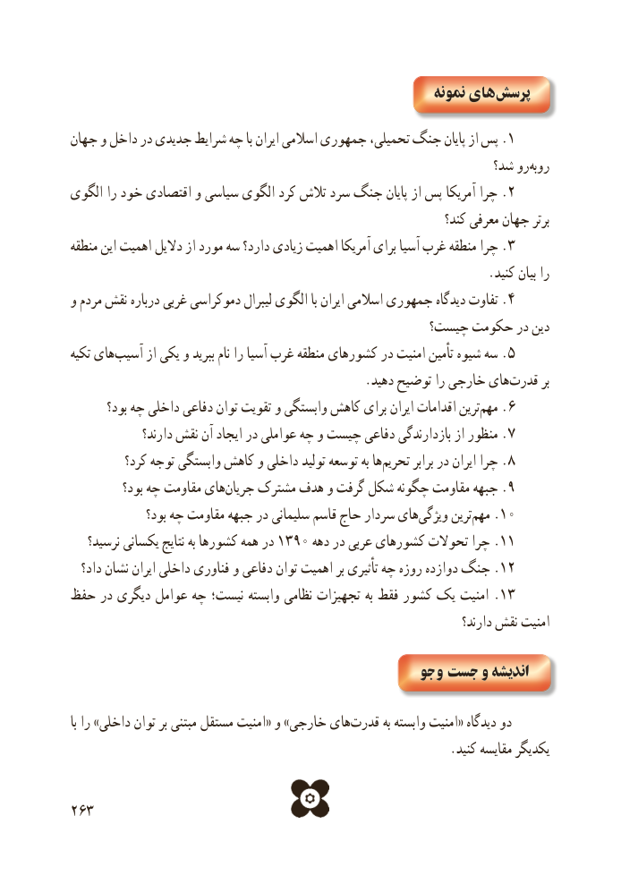

# PDF page 271

نمونه های پرسش
جهان و داخل در جدیدی شرایط چه با ایران اسالمی جمهوری تحمیلی، جنگ پایان از پس .1
                                                               شد؟ روروبه‌
الگوی را خود اقتصادی و سیاسی الگوی کرد تالش سرد جنگ پایان از پس آمریکا چرا .2
                                                                      کند؟ معرفی جهان برتر
منطقه این اهمیت دالیل از مورد سه دارد؟ زیادی اهمیت آمریکا برای آسیا غرب منطقه چرا .3
                                                                   .کنید بیان را
و مردم نقش درباره غربی دموکراسی لیبرال الگوی با ایران اسالمی جمهوری دیدگاه تفاوت .4
                                              چیست؟ حکومت در دین
تکیه های ‌.آسیب از یکی و ببرید نام را آسیا غرب منطقه کشورهای در امنیت تأمین شیوه سه 5
                                               .دهید توضیح را خارجی هایقدرت‌       بر
       بود؟ چه داخلی دفاعی توان تقویت و وابستگی کاهش برای ایران اقدامات ترینمهم‌.6
              دارند؟ نقش آن ایجاد در عواملی چه و چیست دفاعی بازدارندگی از منظور .7
          کرد؟ توجه وابستگی کاهش و داخلی تولید توسعه به هاتحریم‌.برابر در ایران چرا 8
          بود؟ چه مقاومت هایجریان‌.مشترک هدف و گرفت شکل چگونه مقاومت جبهه 9
               بود؟ چه مقاومت جبهه در سلیمانی قاسم حاج سردار هایویژگی‌      ترینمهم‌.10
 نرسید؟۱۳۹۰یکسانی نتایج به کشورها همه در       دهه در عربی کشورهای تحوالت چرا .11
  داد؟ نشان ایران داخلی فناوری و دفاعی توان اهمیت بر تأثیری چه روزه دوازده جنگ .12
حفظ در دیگری عوامل چه نیست؛ وابسته نظامی تجهیزات به فقط کشور یک امنیت .13
                                                                              دارند؟ نقش امنیت

                                               جو و  جست و اندیشه

با را »داخلی توان بر مبتنی مستقل امنیت« و »خارجی های ‌قدرت به وابسته امنیت« دیدگاه دو
                                                             .کنید مقایسه یکدیگر

263

