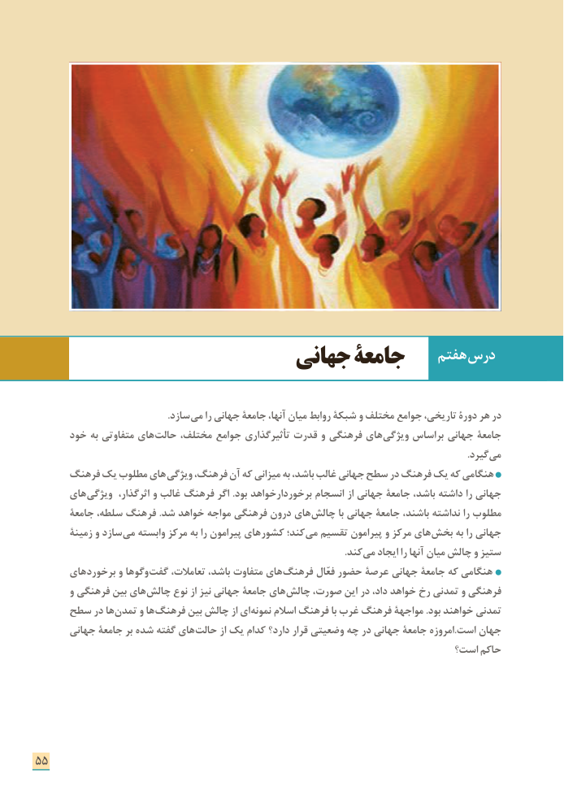

# PDF page 63

هفتم درس                       جهانی جامعۀ

                                                      .سازد می را جهانی جامعۀ آنها، میان روابط شبكۀ و مختلف جوامع تاریخی، دورۀ هر در
      خود به متفاوتی های حالت مختلف، جوامع تأثیرگذاری قدرت و فرهنگی های ویژگی براساس جهانی جامعة
                                    . گیردمی
      فرهنگ یک مطلوب های ویژگی فرهنگ، آن كه میزانی به باشد، غالب جهانی سطح در فرهنگ یک كه هنگامی
      های ویژگی اثرگذار، و غالب فرهنگ اگر .بود برخوردارخواهد انسجام از جهانی جامعۀ باشد، داشته را جهانی
       جامعۀ سلطه، فرهنگ .شد خواهد مواجه فرهنگی درون های چالش با جهانی جامعۀ باشند، نداشته را مطلوب
       زمینۀ و سازد می وابسته مركز به را پیرامون های كشور كند؛ می تقسیم پیرامون و مركز های بخش به را جهانی
                                                                                                                              .كند می ایجاد را آنها میان چالش و ستیز
      های برخورد و وگوها گفت تعامالت، باشد، متفاوت های فرهنگ فعّال حضور عرصة جهانی جامعۀ كه هنگامی
       و فرهنگی بین های چالش نوع از نیز جهانی جامعۀ های چالش صورت، این در داد، خواهد رخ تمدنی و فرهنگی
     سطح در ها تمدن و ها فرهنگ بین چالش از ای نمونه اسالم فرهنگ با غرب فرهنگ مواجهة .بود خواهند تمدنی
      جهانی جامعۀ بر شده گفته های حالت از یک كدام دارد؟ قرار وضعیتی چه در جهانی جامعۀ امروزه.است جهان
                                                                      است؟ حاكم

55

