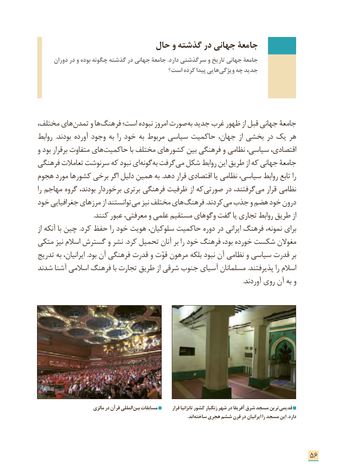

# PDF page 64

حال و گذشته در جهانی جامعۀ
      دوران در و بوده چگونه گذشته در جهانی جامعۀ .دارد سرگذشتی و تاریخ جهانی جامعۀ
                                     است؟ كرده پیدا هایی ویژگی چه جدید

،هایمختلف       تمدن و ها فرهنگ است؛ نبوده امروز صورت به جدید غرب ظهور از قبل جهانی جامعۀ
روابط  .بودند آورده وجود به را خود به مربوط سیاسی حاكمیت جهان، از بخشی در یک هر
و بود برقرار متفاوت های حاكمیت با مختلف های كشور بین فرهنگی و نظامی سیاسی، اقتصادی،
فرهنگی تعامالت سرنوشت كه نبود ای گونه به گرفت می شكل روابط این طریق از كه جهانی جامعۀ
هجوم مورد كشورها برخی اگر دلیل همین به .دهد قرار اقتصادی یا نظامی سیاسی، روابط تابع را
را مهاجم گروه بودند، برخوردار برتری فرهنگی ظرفیت از كه صورتی در گرفتند، می قرار نظامی
خود جغرافیایی های مرز از توانستند می نیز مختلف های فرهنگ .كردند می جذب و هضم خود درون
 . کنند عبور معرفتی، و علمی مستقیم های وگو گفت یا تجاری روابط طریق از
از آنكه با چین .كرد حفظ را خود هویت سلوكیان، حاكمیت دوره در ایرانی فرهنگ نمونه، برای
متكی نیز اسالم گسترش و نشر .كرد تحمیل آنان بر را خود فرهنگ بود، خورده شكست مغوالن
تدریج به ایرانیان، .بود آن فرهنگی قدرت و قوّت مرهون بلکه نبود آن نظامی و سیاسی قدرت بر
شدند آشنا اسالمی فرهنگ با تجارت طریق از شرقی جنوب آسیای مسلمانان .پذیرفتند را اسالم
                                                                                                                                     .آوردند روی آن به و

                         مالزی در قرآن المللی بین مسابقات        قرار تانزانیا کشور زنگبار شهر در آفریقا شرق مسجد ترین قدیمی
                                                                                                                                .اند ساخته هجری ششم قرن در ایرانیان را مسجد این .دارد

                                                                      56

