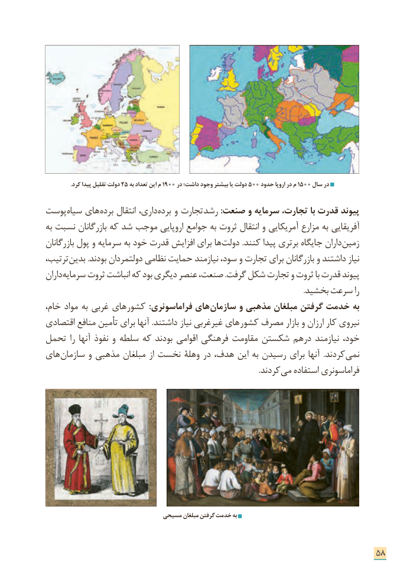

# PDF page 66

.25کرد پیدا تقلیل دولت    به تعداد این م 1900 در داشت؛ وجود بیشتر یا دولت 500 حدود اروپا در م 1500 سال در

پوست سیاه های برده انتقال داری، برده و تجارت رشد :صنعت و سرمایه تجارت، با قدرت پیوند
به نسبت بازرگانان که شد موجب اروپایی جوامع به ثروت انتقال و آمریكایی مزارع به آفریقایی
بازرگانان پول و سرمایه به خود قدرت افزایش برای ها دولت .كنند پیدا برتری جایگاه داران زمین
ترتیب، بدین .بودند دولتمردان نظامی حمایت نیازمند سود، و تجارت برای بازرگانان و داشتند نیاز
داران سرمایه ثروت انباشت كه بود دیگری عنصر صنعت، .گرفت شكل تجارت و ثروت با قدرت پیوند
                                                                                                                                         .بخشید سرعت را
خام، مواد به غربی های كشور  :فراماسونری های سازمان و مذهبی مبلغان گرفتن خدمت به
اقتصادی منافع تأمین برای آنها .داشتند نیاز غیرغربی های كشور مصرف بازار و ارزان كار نیروی
تحمل را آنها نفوذ و سلطه كه بودند اقوامی فرهنگی مقاومت شكستن درهم نیازمند خود،
های سازمان و مذهبی مبلغان از نخست وهلۀ در هدف، این به رسیدن برای آنها  .كردند نمی
                                                                                                                 .كردند می استفاده فراماسونری

                               مسیحی مبلغان گرفتن خدمت به

                                                                      58

