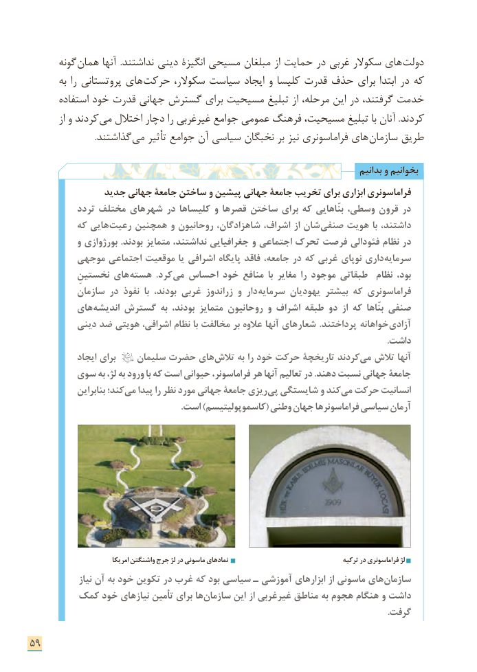

# PDF page 67

گونه همان آنها  .نداشتند دینی انگیزۀ مسیحی مبلغان از حمایت در غربی سكوالر های دولت
       به را پروتستانی های حركت سكوالر، سیاست ایجاد و كلیسا قدرت حذف برای ابتدا در كه
       استفاده خود قدرت جهانی گسترش برای مسیحیت تبلیغ از مرحله، این در گرفتند، خدمت
         از و كردند می اختالل دچار را غیرغربی جوامع عمومی فرهنگ مسیحیت، تبلیغ با آنان .كردند
                             .گذاشتند می تأثیر جوامع آن سیاسی نخبگان بر نیز فراماسونری های سازمان طریق

                                                                                       بدانیم و بخوانیم
              جدید جهانی جامعۀ ساختن و پیشین جهانی جامعۀ تخریب برای ابزاری فراماسونری
           تردد مختلف های شهر در کلیساها و قصرها ساختن برای که بنّاهایی وسطی، قرون در
          که هایی رعیت همچنین و روحانیون شاهزادگان، اشراف، از شان صنفی هویت با داشتند،
           و بورژوازی .بودند متمایز نداشتند، جغرافیایی و اجتماعی تحرک فرصت فئودالی نظام در
        موجهی اجتماعی موقعیت یا اشرافی پایگاه فاقد جامعه، در که غربی نوپای داری سرمایه
          نخستینِ های هسته  .کرد می احساس خود منافع  با مغایر را موجود طبقاتی  نظام بود،
          سازمان در نفوذ  با بودند، غربی زراندوز و دار سرمایه یهودیان بیشتر که فراماسونری
         های اندیشه گسترش به بودند، متمایز روحانیون و اشراف طبقه دو از که بنّاها صنفی
          دینی ضد هویتی اشرافی، نظام با مخالفت بر عالوه آنها های شعار .پرداختند خواهانه آزادی
                                                                                                                                                             .داشت
            ایجاد برای    سلیمان حضرت های تالش به را خود حرکت تاریخچۀ كردند می تالش آنها
       سوی به لژ، به ورود با که است حیوانی فراماسونر، هر آنها تعالیم در .دهند نسبت جهانی جامعة
             بنابراین کند؛ می پیدا را نظر مورد جهانی جامعۀ ریزی پی شایستگی و کند می حرکت انسانیت
                                                                  .است )کاسموپولیتیسم( وطنی جهان فراماسونرها سیاسی آرمان

                              امریکا واشنگتن جرج لژ در ماسونی نمادهای                                    ترکیه در فراماسونری لژ
               نیاز آن به خود تکوین در غرب که بود سیاسی ـ آموزشی های ابزار از ماسونی های سازمان
       کمک خود های نیاز تأمین برای ها سازمان این از غیرغربی مناطق به هجوم هنگام و داشت
                                                                                                                                                             .گرفت

59

