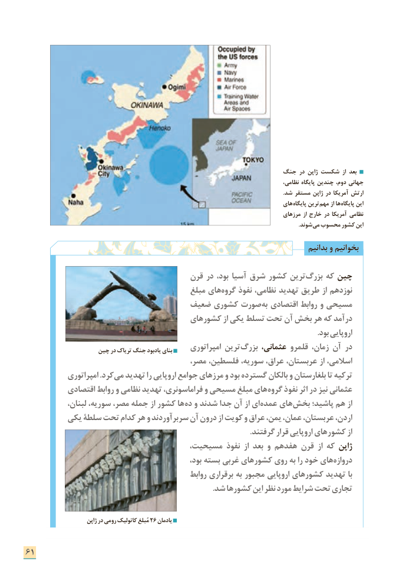

# PDF page 69

جنگ در ژاپن شکست از بعد
                   ،جهانینظامی پایگاه چندین دوم،
                                                                                                                                                                                     .شد مستقر ژاپن در آمریکا ارتش
                                                                               های پایگاه ترین مهم از ها پایگاه این
                                                                                       مرزهای از خارج در آمریکا نظامی
                                    . شوند می محسوب کشور این

                                                                                       بدانیم و بخوانیم

                                      قرن در بود، آسیا شرق كشور ترین بزرگ كه چین
                                          مبلغ های گروه نفوذ نظامی، تهدید طریق از نوزدهم
                               ضعیف كشوری صورت به اقتصادی روابط و مسیحی
                                     های كشور از یكی تسلط تحت آن بخش هر كه درآمد
                                                                                                                                                     .بود اروپایی
                    چین در تریاک جنگ یادبود بنای     امپراتوری ترین بزرگ عثمانی، قلمرو زمان، آن در
                                        مصر، فلسطین، سوریه، عراق، عربستان، از اسالمی،
            امپراتوری .كرد می تهدید را اروپایی جوامع مرزهای و بود گسترده بالكان و بلغارستان تا تركیه
           اقتصادی روابط و نظامی تهدید فراماسونری، و مسیحی مبلغ های گروه نفوذ اثر در نیز عثمانی
             لبنان، سوریه، مصر، جمله از كشور ها ده و شدند جدا آن از ای عمده های بخش پاشید؛ هم از
         یكی سلطة تحت كدام هر و سربرآوردند آن درون از كویت و عراق یمن، عمان، عربستان، اردن،
      . گرفتند قرار اروپایی های كشور از
                                   مسیحیت، نفوذ از بعد و هفدهم قرن از كه ژاپن
                                                      بود، بسته غربی های كشور روی به را خود های دروازه
                                                روابط برقراری به مجبور اروپایی های كشور تهدید با
                 . شد هاكشور این نظر مورد شرایط تحت تجاری

                        ژاپن در رومی کاتولیک مُبلغ 26 یادمان

61

