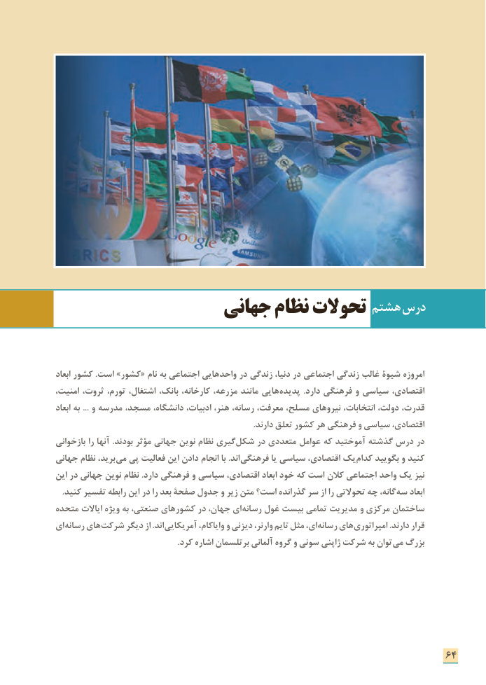

# PDF page 72

هشتم درس                  جهانی نظام تحوالت

ابعاد کشور .است »کشور« نام به اجتماعی واحدهایی در زندگی دنیا، در اجتماعی زندگی غالب شيوة امروزه
امنیت، ثروت، تورم، اشتغال، بانک، کارخانه، مزرعه، مانند هایی پدیده .دارد فرهنگی و سیاسی اقتصادی،
ابعاد به ... و مدرسه مسجد، دانشگاه، ادبیات، هنر، رسانه، معرفت، مسلح، نیروهای انتخابات، دولت، قدرت،
                                                                                              .دارند تعلق کشور هر فرهنگی و سیاسی اقتصادی،
بازخوانی را آنها .بودند مؤثر جهانی نوین نظام گیری شکل در متعددی عوامل که آموختید گذشته درس در
جهانی نظام برید، می پی فعالیت این دادن انجام با .اند فرهنگی یا سیاسی اقتصادی، یک کدام بگویید و کنید
این در جهانی نوین نظام .دارد فرهنگی و سیاسی اقتصادی، ابعاد خود که است کالن اجتماعی واحد یک نیز
. کنید تفسیر رابطه این در را بعد صفحة جدول و زیر متن است؟ گذرانده سر از را تحوالتی چه گانه، سه ابعاد
متحده  ایاالت ویژه به صنعتی، کشورهای در جهان، ای رسانه غول بیست تمامی مدیریت و مرکزی ساختمان
ای رسانه های شركت ديگر از .اند آمریکایی وایاکام، و دیزنی وارنر، تایم مثل ای، رسانه های امپراتوری .دارند قرار
                                                          .كرد اشاره برتلسمان آلمانی گروه و سونی ژاپنی شرکت به توان می بزرگ

                                                                      64

