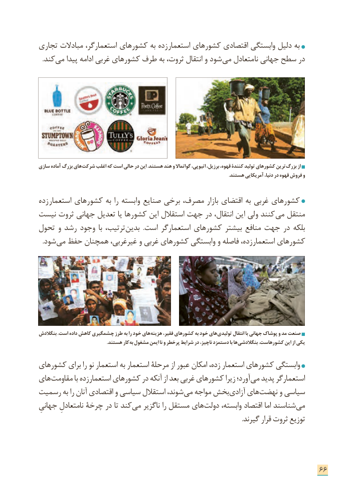

# PDF page 74

تجاری مبادالت استعمارگر، کشورهای به زده استعمار کشورهای اقتصادی وابستگی دلیل به
  .کند می پیدا ادامه غربی کشورهای طرف به ثروت، انتقال و شود می متعادل نا جهانی سطح در

سازی آماده بزرگ های شرکت اغلب که است حالی در این .هستند هند و گواتماال اتیوپی، برزیل، قهوه، کنندة تولید کشورهای ترین بزرگ از
                                                                                                                                                             .هستند آمریکایی دنیا، در قهوه فروش و

زده استعمار کشورهای به را وابسته صنایع برخی مصرف، بازار اقتضای به غربی کشورهای
نیست ثروت جهانی تعدیل یا کشورها این استقالل جهت در انتقال، این ولی کنند می منتقل
تحول و رشد وجود  با ترتیب، بدین  .است استعمارگر کشورهای بیشتر منافع جهت در بلکه
. شود می حفظ همچنان غیرغربی، و غربی کشورهای وابستگی و فاصله زده، استعمار کشورهای

بنگالدش .است داده کاهش چشمگیری طرز به را خود های هزینه فقیر، کشورهای به خود های تولیدی انتقال با جهانی پوشاک و مد صنعت
                                                        .هستند کار به مشغول ایمن نا و پرخطر شرایط در ناچیز، دستمزد با ها بنگالدشی .کشورهاست این از یکی

كشورهای برای را نو استعمار به استعمار مرحلة از عبور امکان زده، استعمار کشورهای وابستگی
های مقاومت با زده استعمار کشورهای در آنکه از بعد غربی کشورهای زیرا آورد؛ می پدید استعمارگر
رسميت به را آنان اقتصادی و سیاسی استقالل شوند، می مواجه بخش آزادی های نهضت و سیاسی
جهانیِ نامتعادلِ چرخة در تا کند می ناگزیر را مستقل های دولت وابسته، اقتصاد اما شناسند می
                                                                                                                               .گیرند قرار ثروت توزیع

                                                                      66

