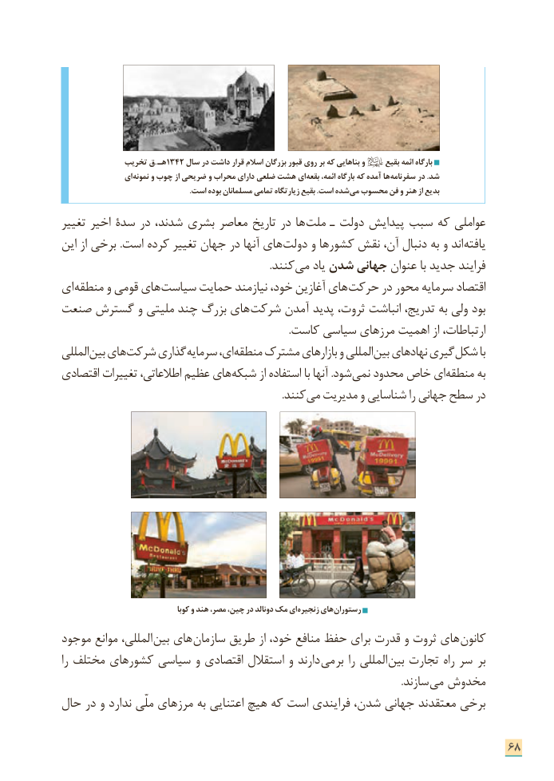

# PDF page 76

تخریب ق .  هـ 1342 سال در داشت قرار اسالم بزرگان قبور روی بر که بناهایی و     بقیع ائمه بارگاه
                ای نمونه و چوب از ضریحی و محراب دارای ضلعی هشت ای بقعه ائمه، بارگاه که آمده ها سفرنامه در .شد
  . است بوده مسلمانان تمامی زیارتگاه بقیع .است شدهمی محسوب فن و هنر از بدیع

تغییر اخیر سدة در شدند، بشری معاصر تاریخ در ها ملت ـ دولت پیدایش سبب که عواملی
این از برخی .است کرده تغییر جهان در آنها های دولت و کشورها نقش آن، دنبال به و اند یافته
              . کنند می یاد شدن جهانی عنوان با جدید فرایند
ای منطقه و قومی های سیاست حمایت نیازمند خود، آغازین های حرکت در محور سرمایه اقتصاد
صنعت گسترش و ملیتی چند بزرگ های شرکت آمدن پدید ثروت، انباشت تدریج، به ولی بود
                                                                                         .کاست سیاسی مرزهای اهمیت از ارتباطات،
المللی بین های شرکت گذاری سرمایه ای، منطقه مشترک بازارهای و المللی بین نهادهای گیری شکل با
اقتصادی تغییرات اطالعاتی، عظیم های شبکه از استفاده با آنها .شود نمی محدود خاص ای منطقه به
                . کنند می مدیریت و شناسایی را جهانی سطح در

                                      کوبا و هند مصر، چین، در دونالد مک ای زنجیره های رستوران
موجود موانع المللی، بین های سازمان طریق از خود، منافع حفظ برای قدرت و ثروت های  کانون
را مختلف کشورهای سیاسی و اقتصادی استقالل و دارند می  بر را المللی  بین تجارت راه سر   بر
                     . سازند می مخدوش
حال در و ندارد ملّی مرزهای به اعتنایی هیچ که است فرایندی شدن، جهانی معتقدند برخی

                                                                      68

