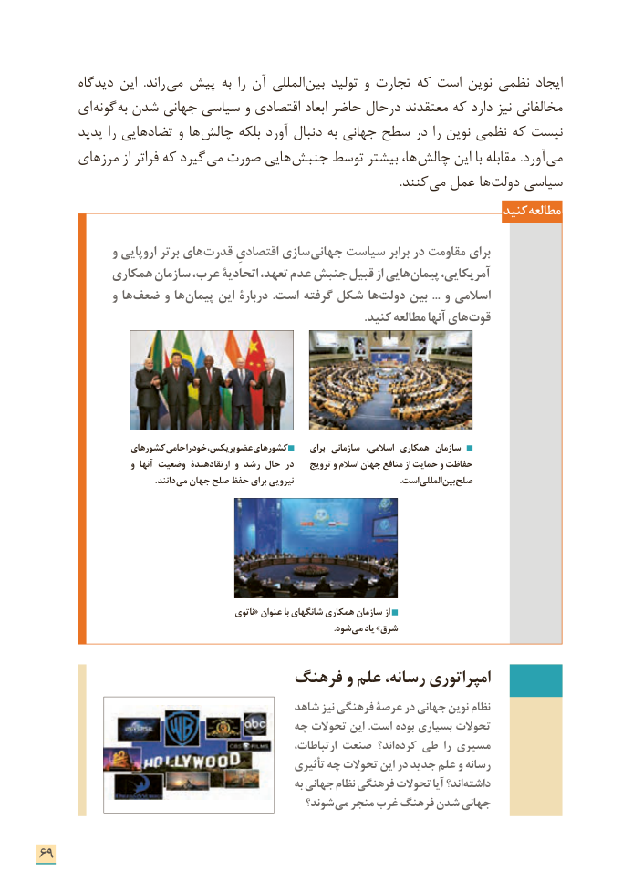

# PDF page 77

دیدگاه این  .راند می پیش به را آن المللی  بین تولید و تجارت که است نوین نظمی ایجاد
     ای  گونه به شدن جهانی سیاسی و اقتصادی ابعاد حاضر درحال معتقدند که دارد نیز مخالفانی
      پدید را تضادهایی و ها چالش بلکه آورد دنبال به جهانی سطح در را نوین نظمی که نیست
      مرزهای از فراتر که گیرد  می صورت هایی  جنبش توسط بیشتر ها،  چالش این با مقابله .آورد  می
                      . کنند می عمل ها  دولت سیاسی
                                                                           کنید مطالعه

             و اروپایی برتر های قدرت اقتصادیِ سازی جهانی سیاست برابر در مقاومت برای
           همکاری سازمان عرب، اتحادیة تعهد، عدم جنبش قبیل از هایی پیمان آمریکایی،
             و ها ضعف و ها پیمان این دربارۀ .است گرفته شکل ها دولت بین ... و اسالمی
      . کنید مطالعه آنها های قوت

                  کشورهای حامی را خود بریکس، عضو کشورهای     برای سازمانی اسالمی، همکاری سازمان
                      و آنها وضعیت ارتقادهندۀ و رشد حال در    ترویج و اسالم جهان منافع از حمایت و حفاظت
          . دانند می جهان صلح حفظ برای نیرویی     . است المللیبین صلح

                                                  ناتوی« عنوان با شانگهای همکاری سازمان از
                                                                                                                                      .شود می یاد »شرق

                          فرهنگ و علم رسانه، امپراتوری
                                        شاهد نیز فرهنگی عرصة در جهانی نوین نظام
                                    چه تحوالت این .است بوده بسياری تحوالت
                                                     ارتباطات، صنعت اند؟ کرده طی را مسیری
                                                  تأثیری چه تحوالت این در جدید علم و رسانه
                                                        به جهانی نظام فرهنگی تحوالت آیا اند؟ داشته
                                              شوند؟ می منجر غرب فرهنگ شدن جهانی

69

