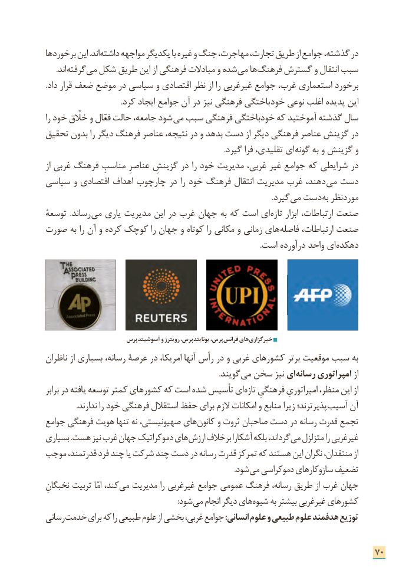

# PDF page 78

برخوردها این .اند داشته مواجهه یکدیگر با غیره و جنگ مهاجرت، تجارت، طریق از جوامع گذشته، در
  . اند گرفته می شکل طریق این از فرهنگی مبادالت و شده می ها فرهنگ گسترش و انتقال سبب
.داد قرار ضعف موضع در سیاسی و اقتصادی نظر از را غیرغربی جوامع غرب، استعماری برخورد
 . کرد ایجاد جوامع آن در نیز فرهنگی باختگی خود نوعی اغلب پدیده این
را خود خااّلّق و فعّال حالت جامعه، شود می سبب فرهنگی خودباختگی که آموختید گذشته سال
تحقیق بدون را دیگر فرهنگ عناصر نتیجه، در و بدهد دست از دیگر فرهنگی عناصر گزینش در
     . گیرد فرا تقلیدی، ای گونه به و گزینش و
از غربی فرهنگ مناسبِ عناصرِ گزینشِ در را خود مدیریت غربی، غیر جوامع که شرایطی در
سیاسی و اقتصادی اهداف چارچوب در را خود فرهنگ انتقال مدیریت غرب دهند، می دست
                      . گیرد می دست به موردنظر
توسعة  .رساند می یاری مدیریت این در غرب جهان به که است ای تازه ابزار ارتباطات، صنعت
صورت به را آن و کرده کوچک را جهان و کوتاه را مکانی و زمانی های فاصله ارتباطات، صنعت
     . است درآورده واحد ای دهکده

                        آسوشیتدپرس و رویترز یونایتدپرس، پرس، فرانس های خبرگزاری
ناظران از بسیاری رسانه، عرصة در امریکا، آنها رأس در و غربی کشورهای برتر موقعیت سبب به
              . گویند می سخن نیز ای رسانه امپراتوری از
برابر در یافته توسعه کمتر کشورهای که است شده تأسیس ای تازه فرهنگیِ امپراتوریِ منظر، این از
. ندارند را خود فرهنگی استقالل حفظ برای الزم امکانات و منابع زیرا پذیرترند؛ آسیب آن
جوامع فرهنگی هویت تنها نه صهیونیستی، های کانون و ثروت صاحبان دست در رسانه قدرت تجمع
بسیاری .هست نیز غرب جهان دموکراتیک های ارزش برخالف آشکارا بلکه گرداند، می متزلزل را غیرغربی
موجب قدرتمند، فرد چند یا شرکت چند دست در رسانه قدرت تمرکز که هستند این نگران منتقدان، از
                     . شود می دموکراسی سازوکارهای تضعیف
نخبگانِ تربیت امّا کند، می مدیریت را غیرغربی جوامع عمومی فرهنگ رسانه، طریق از غرب جهان
               : شود می انجام دیگر های شیوه به بیشتر غیرغربی کشورهای
رسانی خدمت برای که را طبیعی علوم از بخشی غربی، جوامع :انسانی علوم و طبیعی علوم هدفمند توزیع

                                                                      70

