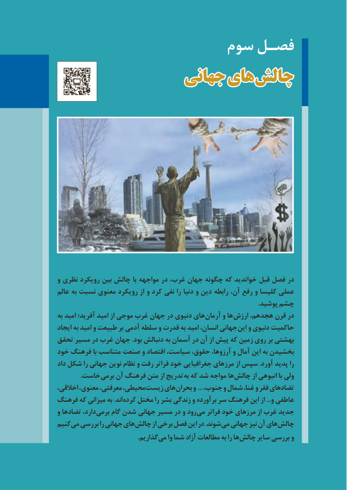

# PDF page 81

سوم فصـل
                    جهانیجهانی هایهای  چالشچالش

           و نظری رویکرد بین چالش با مواجهه در غرب، جهان چگونه که خواندید قبل فصل در
            عالم به نسبت معنوی رویکرد از و کرد نفی را دنیا و دین رابطه آن، رفع و کلیسا عملی
                                                                                                                                              .پوشید چشم
             به امید آفرید؛ امید از موجی غرب جهان در دنیوی های آرمان و ها ارزش هجدهم، قرن در
            ایجاد به امید و طبیعت بر آدمی سلطه و قدرت به امید انسان، جهانی این و دنیوی حاکمیت
         تحقق مسیر در غرب جهان .بود دنبالش به آسمان در آن از پیش که زمین روی بر بهشتی
         خود فرهنگ با متناسب صنعت و اقتصاد سیاست، حقوق، آرزوها، و آمال این به بخشیدن
            داد شکل را جهانی نوین نظام و رفت فراتر خود جغرافیایی مرزهای از سپس .آورد پدید را
     . خاست برمی آن فرهنگ متن از تدریج به که شد مواجه ها چالش از انبوهی با ولی
            اخالقی، معنوی، معرفتی، محیطی، زیست های بحران و ... جنوب، و شمال غنا، و فقر تضادهای
         فرهنگ که میزانی به .اند کرده مختل را بشر زندگی و برآورده سر فرهنگ این از ...و عاطفی
           و تضادها دارد، برمی گام شدن جهانی مسیر در و رود می فراتر خود مرزهای از غرب جدید
          کنیم می بررسی را جهانی های چالش از برخی فصل این در .شوند می جهانی نیز آن های چالش
           . گذاریم می وا شما آزاد مطالعات به را ها چالش سایر بررسی و

73

