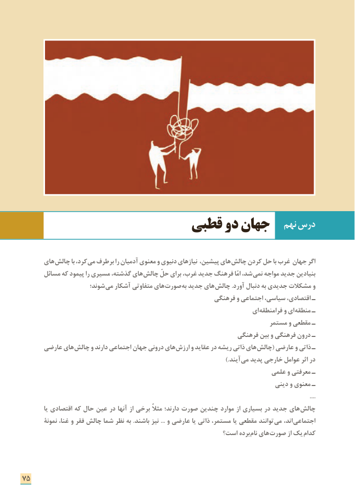

# PDF page 83

نهم درس                      قطبی دو جهان

      های چالش با کرد، می برطرف را آدمیان معنوی و دنیوی نیازهای پیشین، های چالش کردن حل با غرب جهان اگر
      مسائل که پیمود را مسیری گذشته، های چالش حلّ برای غرب، جدید فرهنگ امّا شد، نمی مواجه جدید بنیادین
                      شوند؛ می آشکار متفاوتی های صورت به جدید های چالش .آورد دنبال به جدیدی مشکالت و
                                                      فرهنگی و اجتماعی سیاسی، اقتصادی، ـ
                                                                      ای فرامنطقه و ای منطقه ـ
                                                                      مستمر و مقطعی ـ
                                                             فرهنگی بین و فرهنگی درون ـ
      عارضی های چالش و دارند اجتماعی جهان درونی های ارزش و عقاید در ریشه ذاتی های چالش( عارضی و ذاتی ـ
                                    .) آیند می پدید خارجی عوامل اثر در
                                                                     علمی و معرفتی ـ
                                                                            دینی و معنوی ـ
                                                                                                                                                                                                 ....
          یا اقتصادی که حال عین در آنها از برخی مثالً دارند؛ صورت چندین موارد از بسیاری در جدید های چالش
        نمونة غنا، و فقر چالش شما نظر به .باشند نیز ... و عارضی یا ذاتی مستمر، یا مقطعی توانند می ند، ا اجتماعی
                                                     است؟ برده نام های صورت از یک کدام

75

