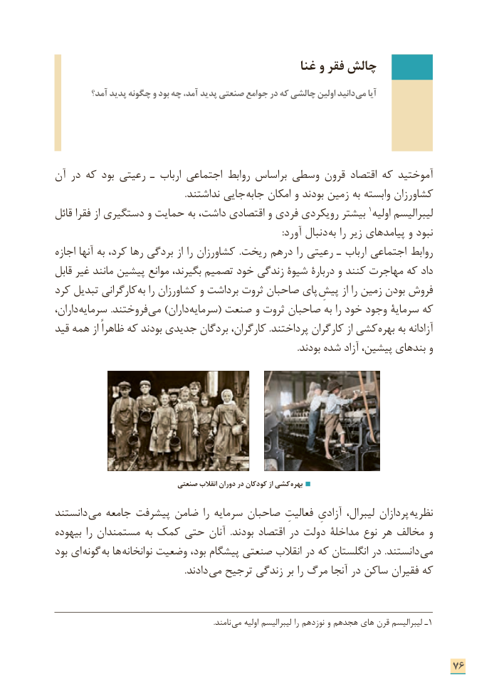

# PDF page 84

غنا و فقر چالش
         آمد؟ پدید چگونه و بود چه آمد، پدید صنعتی جوامع در که چالشی اولین دانید می آیا

آن در که بود رعیتی ـ ارباب اجتماعی روابط براساس وسطی قرون اقتصاد که آموختید
                                                         .نداشتند جایی جابه امکان و بودند زمین به وابسته کشاورزان
قائل فقرا از دستگیری و حمایت به داشت، اقتصادی و فردی رویکردی بیشتر 1اولیه لیبرالیسم
         : آورد دنبال به را زیر پیامدهای و نبود
اجازه آنها به کرد، رها بردگی از را کشاورزان  .ریخت درهم را رعیتی ـ ارباب اجتماعی روابط
قابل غیر مانند پیشین موانع بگیرند، تصمیم خود زندگی شیوة دربارة و کنند مهاجرت که داد
کرد تبدیل کارگرانی به را کشاورزان و برداشت ثروت صاحبان پای پیشِفروشاز را زمین بودن
داران، سرمایه .فروختند می )داران سرمایه( صنعت و ثروت صاحبان به را خود وجود سرمایة که
قید همه از ظاهراً که بودند جدیدی بردگان کارگران، .پرداختند کارگران از کشی بهره به آزادانه
                                                                                                           .بودند شده آزاد پیشین، بندهای و

                              صنعتی انقالب دوران در کودکان از کشی بهره

دانستند می جامعه پیشرفت ضامن را سرمایه صاحبان فعالیتِ آزادیِ لیبرال، پردازان نظریه
بیهوده را مستمندان به کمک حتی آنان  .بودند اقتصاد در دولت مداخلة نوع هر مخالف و
بود ای  گونه به ها نوانخانه وضعیت بود، پیشگام صنعتی انقالب در که انگلستان در .دانستند می
          . دادند می ترجیح زندگی بر را مرگ آنجا در ساکن فقیران که

                                                                                           .نامند می اولیه لیبرالیسم را نوزدهم و هجدهم های قرن لیبرالیسم ـ1

                                                                      76

