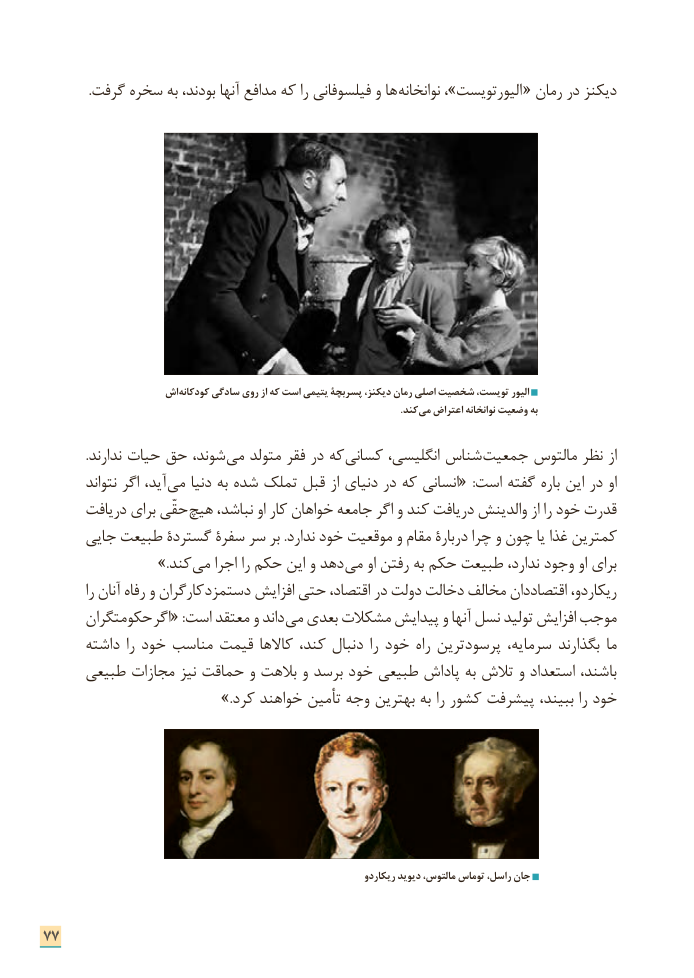

# PDF page 85

.گرفت سخره به بودند، آنها مدافع که را فیلسوفانی و ها نوانخانه ،»الیورتویست « رمان در دیکنز

                  اش کودکانه سادگی روی از که است یتیمی پسربچة دیکنز، رمان اصلی شخصیت تویست، الیور
                                                                                                                                                    .کند می اعتراض نوانخانه وضعیت به

             .ندارند حیات حق شوند، می متولد فقر در که کسانی انگلیسی، شناس جمعیت مالتوس نظر از
        نتواند اگر آید، می دنیا به شده تملک قبل از دنیای در که انسانی«  :است گفته باره این در او
      دریافت برای حقّی هیچ نباشد، او کار خواهان جامعه اگر و کند دریافت والدینش از را خود قدرت
     جایی طبیعت گستردة سفرة سر بر .ندارد خود موقعیت و مقام دربارة چرا و چون یا غذا کمترین
         .» کند می اجرا را حکم این و دهد می او رفتن به حکم طبیعت ندارد، وجود او برای
         را آنان رفاه و کارگران دستمزد افزایش حتی اقتصاد، در دولت دخالت مخالف اقتصاددان ریکاردو،
      حکومتگران اگر« :است معتقد و داند می بعدی مشکالت پیدایش و آنها نسل تولید افزایش موجب
      داشته را خود مناسب قیمت کاالها کند، دنبال را خود راه پرسودترین سرمایه، بگذارند ما
     طبیعی مجازات نیز حماقت و بالهت و برسد خود طبیعی پاداش به تالش و استعداد باشند،
                               .»کرد خواهند تأمین وجه بهترین به را کشور پیشرفت ببیند، را خود

                                                                        ریکاردو دیوید مالتوس، توماس راسل، جان

77

