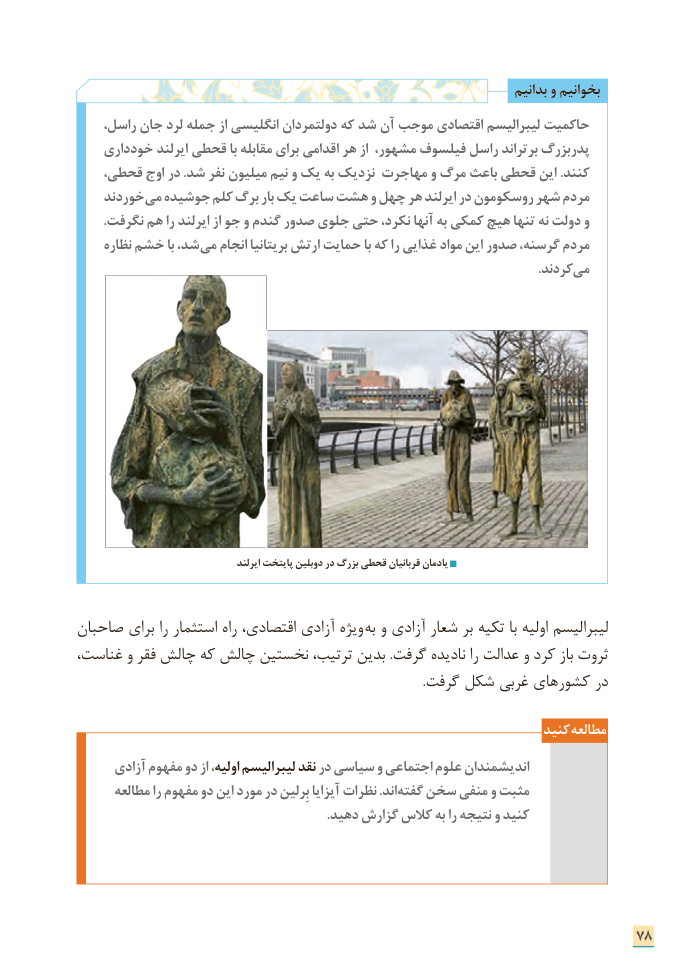

# PDF page 86

بدانیم و بخوانیم
،حاکمیتراسل جان لرد جمله از انگلیسی دولتمردان که شد آن موجب اقتصادی لیبرالیسم
    خودداری ایرلند قحطی با مقابله برای اقدامی هر از مشهور، فیلسوف راسل برتراند پدربزرگ
   قحطی، اوج در .شد نفر میلیون نیم و یک به نزدیک مهاجرت و مرگ باعث قحطی این .کنند
    خوردند می جوشیده کلم برگ بار یک ساعت هشت و چهل هر ایرلند در روسکومون شهر مردم
        .نگرفت هم را ایرلند از جو و گندم صدور جلوی حتی نکرد، آنها به کمکی هیچ تنها نه دولت و
     نظاره خشم با شد، می انجام بریتانیا ارتش حمایت با که را غذایی مواد این صدور گرسنه، مردم
                        . کردندمی

                                         ایرلند پایتخت دوبلین در بزرگ قحطی قربانیان یادمان

صاحبان برای را استثمار راه اقتصادی، آزادی ویژه  به و آزادی شعار بر تکیه با اولیه لیبرالیسم
غناست، و فقر چالش که چالش نخستین ترتیب، بدین .گرفت نادیده را عدالت و کرد باز ثروت
                                                                                                             .گرفت شکل غربی کشورهای در

                                                                     کنید مطالعه
      آزادی مفهوم دو از اولیه، لیبرالیسم نقد در سیاسی و اجتماعی علوم اندیشمندان
      مطالعه را مفهوم دو این مورد در بِرلین آیزایا نظرات .اند گفته سخن منفی و مثبت
                                                                           .دهید گزارش کالس به را نتیجه و کنید

                                                                      78

