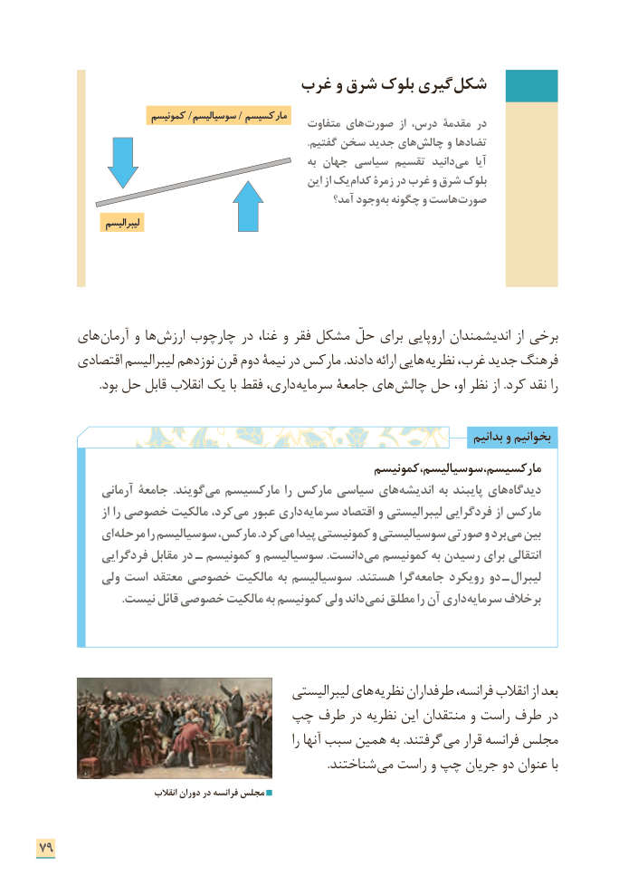

# PDF page 87

غرب و شرق بلوک گیری شکل
                      کمونیسم /سوسیالیسم / مارکسیسم                                                متفاوت های صورت از درس، مقدمۀ در
                                                                                                  .گفتیم سخن جدید های چالش و تضادها
                                                            به جهان سیاسی تقسیم دانید می  آیا
                                                     این از یک کدام زمرۀ در غرب و شرق بلوک
                                                       آمد؟ وجود به چگونه و هاست صورت
                 لیبرالیسم

     های آرمان و ها ارزش چارچوب در غنا، و فقر مشکل حلّ برای اروپایی اندیشمندان از برخی
      اقتصادی لیبرالیسم نوزدهم قرن دوم نیمة در مارکس .دادند ارائه هایی نظریه غرب، جدید فرهنگ
 . بود حل قابل انقالب یک با فقط داری، سرمایه جامعة های چالش حل او، نظر از .کرد نقد را

                                                                                       بدانیم و بخوانیم
                                                   کمونیسم سوسیالیسم، مارکسیسم،
            آرمانی جامعۀ .گویند می مارکسیسم را مارکس سیاسی های اندیشه به پایبند های دیدگاه
               از را خصوصی مالکیت کرد، می عبور داری سرمایه اقتصاد و لیبرالیستی فردگرایی از مارکس
          ای مرحله را سوسیالیسم مارکس، .کرد می پیدا کمونیستی و سوسیالیستی صورتی و برد می بین
           فردگرایی مقابل در ـ کمونیسم و سوسیالیسم .دانست می کمونیسم به رسیدن برای انتقالی
          ولی است معتقد خصوصی مالکیت به سوسیالیسم .هستند گرا جامعه رویکرد دو  ـ لیبرال
 . نیست قائل خصوصی مالکیت به کمونیسم ولی داندنمی مطلق را آن داری سرمایه برخالف

                                            لیبرالیستی های نظریه طرفداران فرانسه، انقالب از بعد
                       چپ طرف در نظریه این منتقدان و راست طرف در
                                                               را آنها سبب همین به .گرفتند می قرار فرانسه مجلس
           . شناختند می راست و چپ جریان دو عنوان با
                              انقالب دوران در فرانسه مجلس

79

