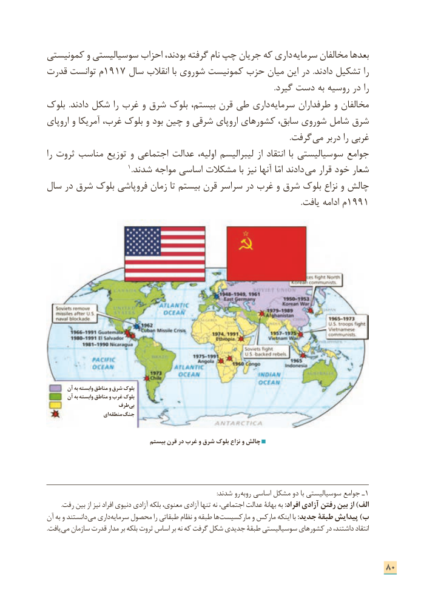

# PDF page 88

کمونیستی و سوسیالیستی احزاب بودند، گرفته نام چپ جریان که داری  سرمایه مخالفان بعدها
قدرت توانست م1917 سال انقالب با شوروی کمونیست حزب میان این در .دادند تشکیل را
                                                                                                                      .گیرد دست به روسیه در را
بلوک  .دادند شکل را غرب و شرق بلوک بیستم، قرن طی داری سرمایه طرفداران و مخالفان
اروپای و آمریکا غرب، بلوک و بود چین و شرقی اروپای کشورهای سابق، شوروی شامل شرق
                   . گرفت می دربر را غربی
را ثروت مناسب توزیع و اجتماعی عدالت اولیه، لیبرالیسم از انتقاد  با سوسیالیستی جوامع
                               1.شدند مواجه اساسی مشکالت با نیز آنها امّا دادند می قرار خود شعار
سال در شرق بلوک فروپاشی زمان تا بیستم قرن سراسر در غرب و شرق بلوک نزاع و چالش
                   .1991یافت ادامه م

       آن به وابسته مناطق و شرق بلوک
       آن به وابسته مناطق و غرب بلوک
                    طرف بی
                     ای منطقه جنگ

                                 بیستم قرن در غرب و شرق بلوک نزاع و چالش

                                                                                                                   :شدند رو روبه اساسی مشکل دو با سوسیالیستی جوامع ـ1
          .رفت بین از نیز افراد دنیوی آزادی بلکه معنوی، آزادی تنها نه اجتماعی، عدالت بهانة به :افراد آزادی رفتن بین از )الف
آن به و دانستند می داری سرمایه محصول را طبقاتی نظام و طبقه ها مارکسیست و مارکس اینکه با :جدید طبقة پیدایش )ب
. یافت می سازمان قدرت مدار بر بلکه ثروت اساس بر نه که گرفت شکل جدیدی طبقة سوسیالیستی کشورهای در داشتند، انتقاد

                                                                      80

