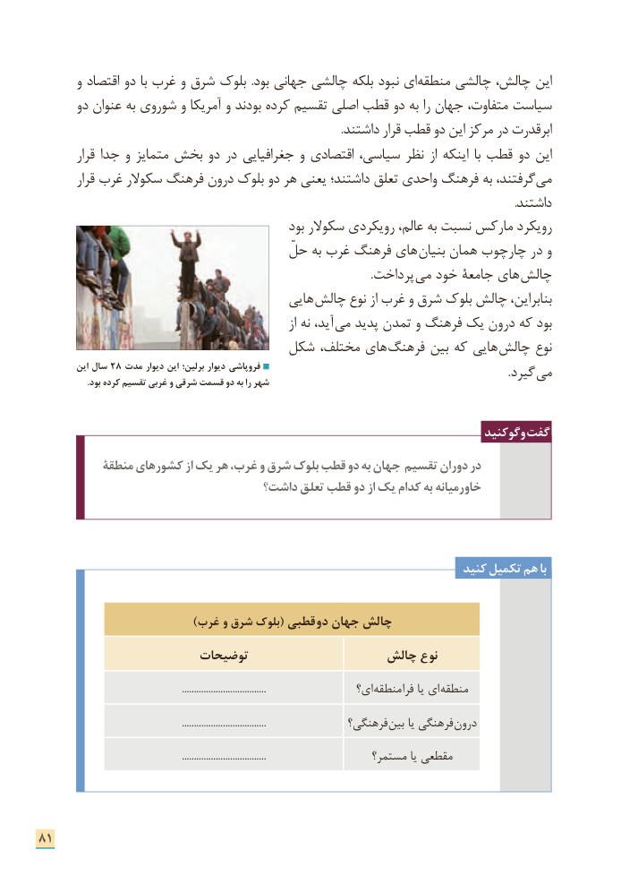

# PDF page 89

و اقتصاد دو با غرب و شرق بلوک  .بود جهانی چالشی بلکه نبود ای منطقه چالشی چالش، این
      دو عنوان به شوروی و آمریکا و بودند کرده تقسیم اصلی قطب دو به را جهان متفاوت، سیاست
    . داشتند قرار قطب دو این مرکز در ابرقدرت
        قرار جدا و متمایز بخش دو در جغرافیایی و اقتصادی سیاسی، نظر از اینکه  با قطب دو این
        قرار غرب سکوالر فرهنگ درون بلوک دو هر یعنی داشتند؛ تعلق واحدی فرهنگ به گرفتند، می
                                                                                                                                                                       .داشتند
                                               بود سکوالر رویکردی عالم، به نسبت مارکس رویکرد
                                       حلّ به غرب فرهنگ های بنیان همان چارچوب در و
              . پرداخت می خود جامعة های  چالش
                                        هایی  چالش نوع از غرب و شرق بلوک چالش بنابراین،
                                                               از نه آید،  می پدید تمدن و فرهنگ یک درون که بود
                            شکل مختلف، های  فرهنگ بین که هایی چالش نوع
         این سال 28 مدت دیوار این برلین؛ دیوار فروپاشی                . گیرد می                      .بود کرده تقسیم غربی و شرقی قسمت دو به را شهر

                                                                           وگوکنید گفت
          منطقة کشورهای از یک هر غرب، و شرق بلوک قطب دو به جهان تقسیم دوران در
                                داشت؟ تعلق قطب دو از یک کدام به خاورمیانه

                                                                      کنید تکمیل هم با

                                )غرب و شرق بلوک( قطبی دو جهان چالش
                       توضیحات                  چالش نوع

                                                           ...................................                ای؟ منطقه فرا یا ای  منطقه

                                                           ...................................              فرهنگی؟ بین یا فرهنگی درون

                                                           ...................................                  مستمر؟ یا مقطعی

81

