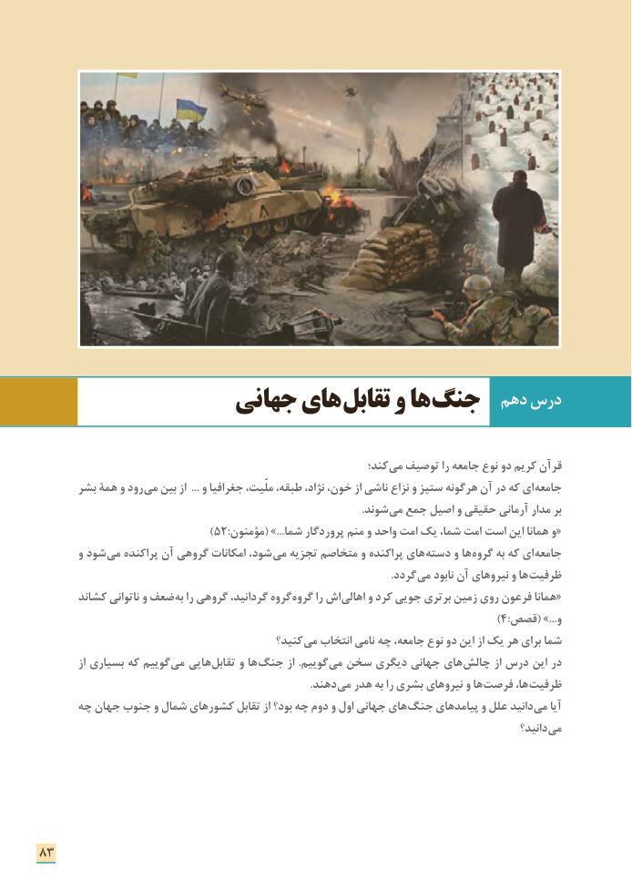

# PDF page 91

دهم درس                جهانی های تقابل و ها جنگ

                                                                کند؛­ می توصیف را جامعه نوع دو کریم قرآن
      بشر همة و رود می بین از  ... و جغرافیا ملّیت، طبقه، نژاد، خون، از ناشی نزاع و ستیز هرگونه آن در که ای­ جامعه
                      . شوند می جمع اصیل و حقیقی آرمانی مدار بر
  )52:«مؤمنون( ...»شما پروردگار منم و واحد امت یک شما، امت است این همانا و
       و شود ­می پراکنده آن گروهی امکانات شود،­ می تجزیه متخاصم و پراکنده های­ دسته و ها ­گروه به که ای جامعه
                                    . ­گردد می نابود آن نیروهای و ها ­ظرفیت
       کشاند ناتوانی و ضعف به را گروهی گردانید، گروه گروه را اش «اهالی و کرد جویی برتری زمین روی فرعون همانا
                                                                                                   )4:قصص( ...»و
                                           کنید؟ می انتخاب نامی چه جامعه، نوع دو این از یک هر برای شما
          از بسیاری که گوییم ­می هایی ­تقابل و ها­ جنگ از .گوییم­ می سخن دیگری جهانی های چالش از درس این در
                           .­ دهند می هدر به را بشری نیروهای و ها­ فرصت ها،­ ظرفیت
     چه جهان جنوب و شمال کشورهای تقابل از بود؟ چه دوم و اول جهانی های ­جنگ پیامدهای و علل دانید می آیا
                                                                                                       دانید؟­ می

83

