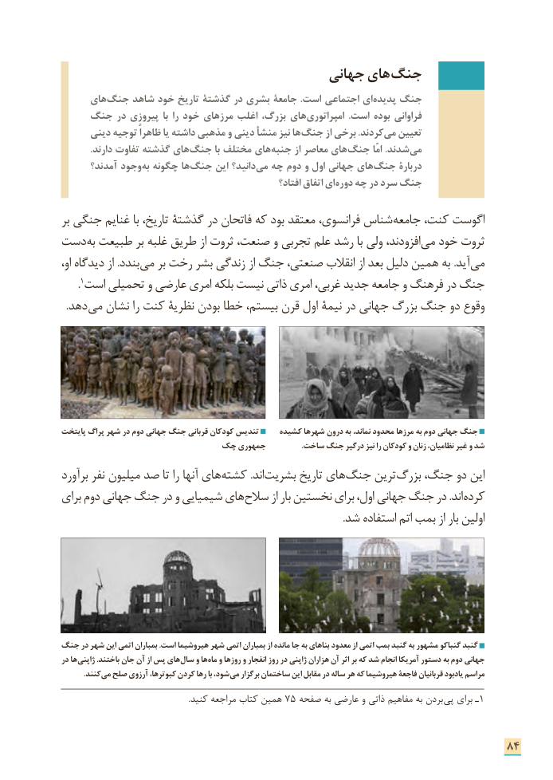

# PDF page 92

جهانی های­ جنگ
     های­ جنگ شاهد خود تاریخ گذشتة در بشری جامعة .است اجتماعی ای پدیده جنگ
    جنگ در پیروزی با را خود مرزهای اغلب بزرگ، های ­امپراتوری  .است بوده فراوانی
      دینی توجیه ظاهراً یا داشته مذهبی و دینی منشأ نیز ها­ جنگ از برخی .کردند ­می تعیین
            .دارند تفاوت گذشته های ­جنگ با مختلف های­ جنبه از معاصر های ­جنگ امّا .شدند ­می
      آمدند؟ وجود به چگونه ها­ جنگ این دانید؟ می چه دوم و اول جهانی های­ جنگ دربارۀ
                                                          افتاد؟ اتفاق ای­ دوره چه در سرد جنگ

بر جنگی غنایم با تاریخ، گذشتة در فاتحان که بود معتقد فرانسوی، شناس­ جامعه کنت، اگوست
دست به طبیعت بر غلبه طریق از ثروت صنعت، و تجربی علم رشد با ولی افزودند،­ می خود ثروت
او، دیدگاه از .بندد­ می بر رخت بشر زندگی از جنگ صنعتی، انقالب از بعد دلیل همین به .آید­ می
      .١جنگاست تحمیلی و عارضی امری بلکه نیست ذاتی امری غربی، جدید جامعه و فرهنگ در
  .دهد­ می نشان را کنت نظریۀ بودن خطا بیستم، قرن اول نیمة در جهانی بزرگ جنگ دو وقوع

پایتخت پراگ شهر در دوم جهانی جنگ قربانی کودکان تندیس     کشیده شهرها درون به نماند، محدود مرزها به دوم جهانی جنگ
                      چک جمهوری                   .ساخت جنگ درگیر نیز را کودکان و زنان نظامیان، غیر و شد
برآورد نفر میلیون صد تا را آنها های­ کشته .اند ­بشریت تاریخ های­ جنگ ترین بزرگ جنگ، دو این
برای دوم جهانی جنگ در و شیمیایی های­ سالح از بار نخستین برای اول، جهانی جنگ در .اند­ کرده
                                                                                                               .شد استفاده اتم بمب از بار اولین

جنگ در شهر این اتمی بمباران .است هیروشیما شهر اتمی بمباران از مانده جا به بناهای معدود از اتمی بمب گنبد به مشهور گنباکو گنبد
در ها ژاپنی .باختند جان آن از پس های سال و ها ماه و روزها و انفجار روز در ژاپنی هزاران آن اثر بر که شد انجام آمریکا دستور به دوم جهانی
  . کنند می صلح آرزوی کبوترها، کردن رها با شود، می برگزار ساختمان این مقابل در ساله هر که هیروشیما فاجعۀ قربانیان یادبود مراسم

                                                                 .کنید مراجعه کتاب همین ٧5 صفحه به عارضی و ذاتی مفاهیم به بردن پی١برای ـ

                                                                      84

