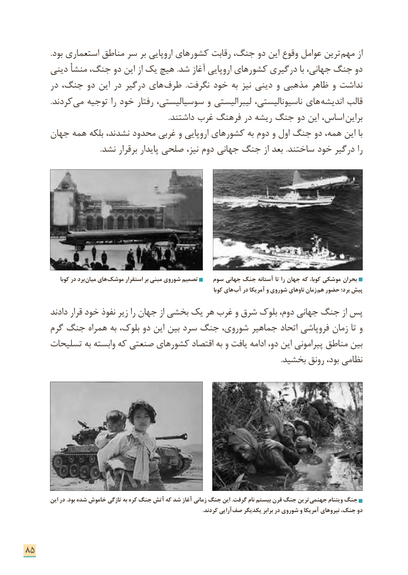

# PDF page 93

.بود استعماری مناطق سر بر اروپایی کشورهای رقابت جنگ، دو این وقوع عوامل ترین ­مهم از
      دینی منشأ جنگ، دو این از یک هیچ .شد آغاز اروپایی کشورهای درگیری با جهانی، جنگ دو
      در جنگ، دو این در درگیر های­ طرف  .نگرفت خود به نیز دینی و مذهبی ظاهر و نداشت
             .کردند­ می توجیه را خود رفتار سوسیالیستی، و لیبرالیستی ناسیونالیستی، های  اندیشه قالب
  . داشتند غرب فرهنگ در ریشه جنگ دو این اساس، براین
     جهان همه بلکه نشدند، محدود غربی و اروپایی کشورهای به دوم و اول جنگ دو همه، این با
                                        .نشد برقرار پایدار صلحی نیز، دوم جهانی جنگ از بعد .ساختند خود درگیر را

               کوبا در برد میان های موشک استقرار بر مبنی شوروی تصمیم    سوم جهانی جنگ آستانه تا را جهان که کوبا، موشکی بحران
                                                                                   کوبا های آب در آمریکا و شوروی ناوهای زمان هم حضور برد؛ پیش
       دادند قرار خود نفوذ زیر را جهان از بخشی یک هر غرب و شرق بلوک دوم، جهانی جنگ از پس
      گرم جنگ همراه به بلوک، دو این بین سرد جنگ شوروی، جماهیر اتحاد فروپاشی زمان تا و
     تسلیحات به وابسته که صنعتی کشورهای اقتصاد به و یافت ادامه دو، این پیرامونی مناطق بین
                                                                                                                                        .بخشید رونق بود، نظامی

         این در .بود شده خاموش تازگی به کره جنگ آتش که شد آغاز زمانی جنگ این .گرفت نام بیستم قرن جنگ ترین جهنمی ویتنام جنگ
                                                                                                                             .کردند آرایی صف یکدیگر برابر در شوروی و آمریکا نیروهای جنگ، دو

85

