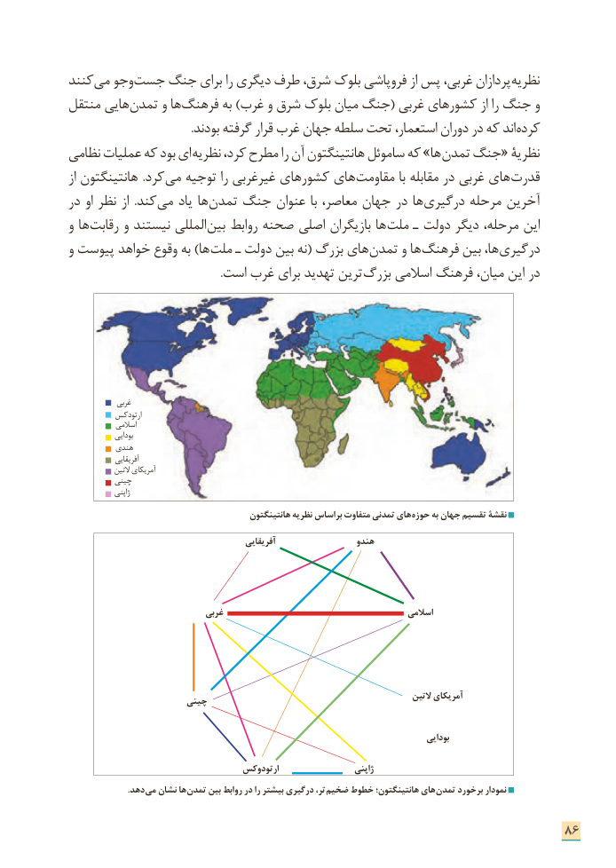

# PDF page 94

کنند می وجو جست جنگ برای را دیگری طرف شرق، بلوک فروپاشی از پس غربی، پردازان ­نظریه
منتقل هایی ­تمدن و ها ­فرهنگ به )غرب و شرق بلوک میان جنگ( غربی کشورهای از را جنگ و
 . ­بودند گرفته قرار غرب جهان سلطه تحت استعمار، دوران در که اند کرده
نظامی عملیات که بود ای­ نظریه کرد، مطرح را آن هانتینگتون ساموئل که »ها ­تمدن جنگ« نظریة
از هانتینگتون   .کرد ­می توجیه را غیرغربی کشورهای های ­مقاومت با مقابله در غربی های ­قدرت
در او نظر از  .کند ­می یاد ها ­تمدن جنگ عنوان با معاصر، جهان در ها ­درگیری مرحله آخرین
و ها رقابت و نیستند المللی بین روابط صحنه اصلی بازیگران ها ملت ـ دولت دیگر مرحله، این
و پیوست خواهد وقوع به )ها ملت ـ دولت بین نه( بزرگ های تمدن و ها فرهنگ بین ها، درگیری
  . است غرب برای تهدید ترین بزرگ اسالمی فرهنگ میان، این در

             غربی
            ارتودکس
             اسالمی
               بودایی
           هندی
               آفریقایی
              التین آمریکای
           چینی
               ژاپنی
                                            هانتینگتون نظریه براساس متفاوت تمدنی های حوزه به جهان تقسیم نقشة

                                              آفریقایی                  هندو

                             غربی                                           اسالمی

                                                                                         التین آمریکای                       چینی

                                                                                             بودایی

                                      ارتودوکس                   ژاپنی
      . دهد می نشان ها تمدن بین روابط در را بیشتر درگیری تر، ضخیم خطوط هانتینگتون؛ های تمدن برخورد نمودار

                                                                      86

