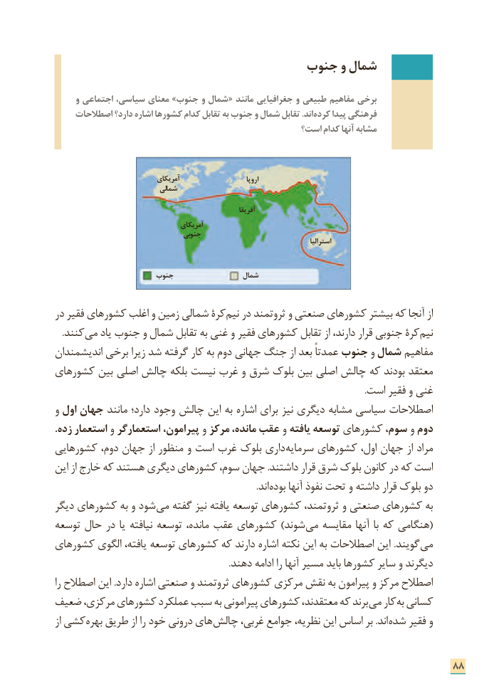

# PDF page 96

جنوب و شمال

     و اجتماعی سیاسی، معنای »جنوب و شمال « مانند جغرافیایی و طبیعی مفاهیم برخی
    اصطالحات دارد؟ اشاره کشورها کدام تقابل به جنوب و شمال تقابل .اند کرده پیدا فرهنگی
                                               است؟ کدام آنها مشابه

                               آمریکای                           اروپا
                             شمالی

                                                                 آفریقا
                                      آمریکای
                                   جنوبی                                                                                               استرالیا

                       جنوب                 شمال

در فقیر کشورهای اغلب و زمین شمالی کرة نیم در ثروتمند و صنعتی کشورهای بیشتر که آنجا از
 . ­کنند می یاد جنوب و شمال تقابل به غنی و فقیر کشورهای تقابل از دارند، قرار جنوبی کرة نیم
اندیشمندان برخی زیرا شد گرفته کار به دوم جهانی جنگ از بعد عمدتاً جنوب و شمال مفاهیم
کشورهای بین اصلی چالش بلکه نیست غرب و شرق بلوک بین اصلی چالش که بودند معتقد
                                                                                                                                         .است فقیر و غنی
و اول جهان مانند دارد؛ وجود چالش این به اشاره برای نیز دیگری مشابه سیاسی اصطالحات
.زده استعمار و استعمارگر پیرامون، و مرکز مانده، عقب و یافته توسعه کشورهای سوم، و دوم
کشورهایی دوم، جهان از منظور و است غرب بلوک داری­ سرمایه کشورهای اول، جهان از مراد
این از خارج که هستند دیگری کشورهای سوم، جهان .داشتند قرار شرق بلوک کانون در که است
                         . اند بوده آنها نفوذ تحت و داشته قرار بلوک دو
دیگر کشورهای به و شود­ می گفته نیز یافته توسعه کشورهای ثروتمند، و صنعتی کشورهای به
توسعه حال در یا نیافته توسعه مانده، عقب کشورهای )شوند­ (می مقایسه آنها با که هنگامی
کشورهای الگوی یافته، توسعه کشورهای که دارند اشاره نکته این به اصطالحات این .گویند­ می
                                                                             .دهند ادامه را آنها مسیر باید کشورها سایر و دیگرند
را اصطالح این .دارد اشاره صنعتی و ثروتمند کشورهای مرکزی نقش به پیرامون و مرکز اصطالح
ضعیف مرکزی، کشورهای عملکرد سبب به پیرامونی کشورهای معتقدند، که برند ­می کار به کسانی
از کشی بهره طریق از را خود درونی های چالش غربی، جوامع نظریه، این اساس بر .اند شده فقیر و

                                                                      88

