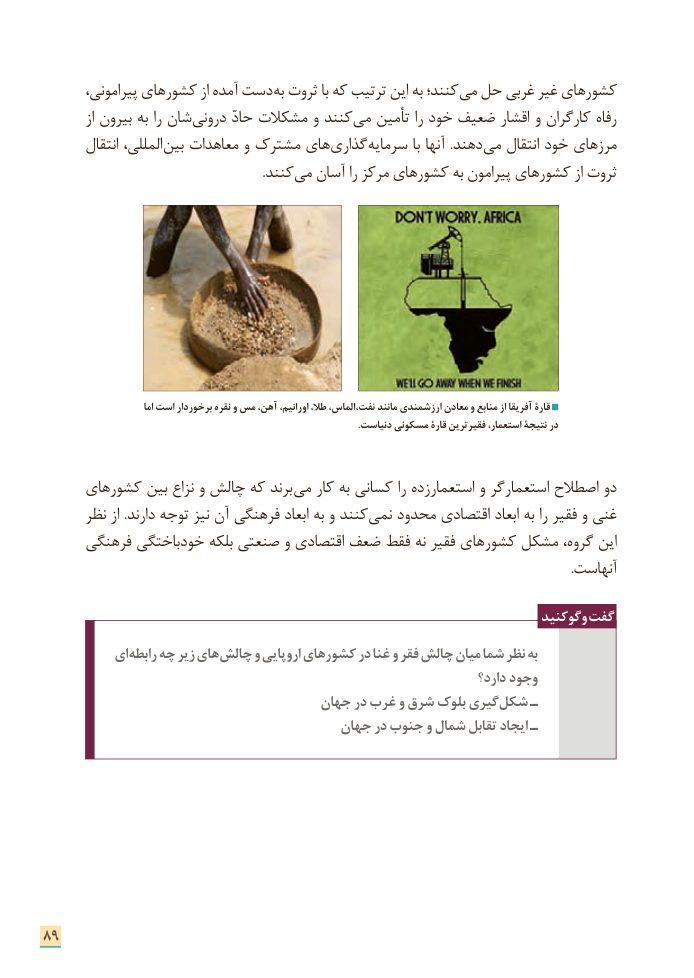

# PDF page 97

پیرامونی، کشورهای از آمده دست به ثروت با که ترتیب این به کنند؛ ­می حل غربی غیر کشورهای
          از بیرون به را شان درونی حادّ مشکالت و کنند­ می تأمین را خود ضعیف اقشار و کارگران رفاه
        انتقال المللی،­ بین معاهدات و مشترک های ­گذاری­ سرمایه با آنها  .دهند­ می انتقال خود مرزهای
                  . ­کنند می آسان را مرکز کشورهای به پیرامون کشورهای از ثروت

                               اما است برخوردار نقره و مس آهن، اورانیم، طال، الماس، ،نفت مانند ارزشمندی معادن و منابع از آفریقا قارۀ
                                                                                                                                  .دنیاست مسکونی قارۀ فقیرترین استعمار، نتیجة در

     کشورهای بین نزاع و چالش که برند ­می کار به کسانی را استعمارزده و استعمارگر اصطالح دو
      نظر از .دارند توجه نیز آن فرهنگی ابعاد به و کنند ­نمی محدود اقتصادی ابعاد به را فقیر و غنی
     فرهنگی خودباختگی بلکه صنعتی و اقتصادی ضعف فقط نه فقیر کشورهای مشکل گروه، این
                                                                                                                                                                      .آنهاست

                                                                           وگوکنید گفت
          ای­ رابطه چه زیر های چالش و اروپایی کشورهای در غنا و فقر چالش میان شما نظر به
                                                                            دارد؟ وجود
                                    جهان در غرب و شرق بلوک گیری شکل ـ
                                      جهان در جنوب و شمال تقابل ایجاد ـ

89

