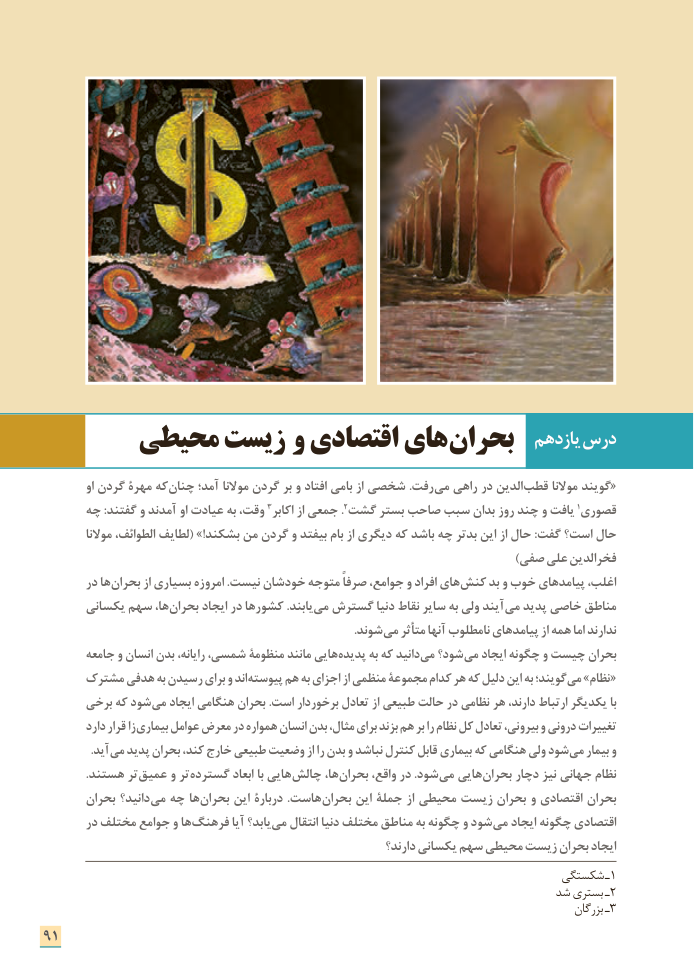

# PDF page 99

یازدهم درس      محیطی زیست  و اقتصادی های بحران
          او گردن مهرۀ که چنان آمد؛ موالنا گردن بر و افتاد بامی از شخصی .رفت می راهی در الدین «قطب موالنا گویند
     چه :گفتند و آمدند او عیادت به وقت، 3.اکابر از جمعی 2گشت بستر صاحب سبب بدان روز چند و یافت 1قصوری
          موالنا الطوائف، لطایف( !»بشکند من گردن و بیفتد بام از دیگری که باشد چه بدتر این از حال :گفت است؟ حال
                                                                                                )صفی علی فخرالدین
       در ها بحران از بسیاری امروزه .نیست خودشان متوجه صرفاً جوامع، و افراد های کنش بد و خوب پیامدهای اغلب،
      یکسانی سهم ها، بحران ایجاد در کشورها .یابند می گسترش دنیا نقاط سایر به ولی آیند می پدید خاصی مناطق
                   . شوند می متأثر آنها نامطلوب پیامدهای از همه اما ندارند
       جامعه و انسان بدن رایانه، شمسی، منظومۀ مانند هایی پدیده به که دانید می شود؟ می ایجاد چگونه و چیست بحران
     مشترک هدفی به رسیدن برای و اند پیوسته هم به اجزای از منظمی مجموعة کدام هر که دلیل این به گویند؛ می »نظام «
      برخی که شود می ایجاد هنگامی بحران .است برخوردار تعادل از طبیعی حالت در نظامی هر دارند، ارتباط یکدیگر با
        دارد قرار زا بیماری عوامل معرض در همواره انسان بدن مثال، برای بزند هم بر را نظام کل تعادل بیرونی، و درونی تغییرات
    . آید می پدید بحران کند، خارج طبیعی وضعیت از را بدن و نباشد کنترل قابل بیماری که هنگامی ولی شود می بیمار و
              .هستند تر عمیق و تر گسترده ابعاد با هایی چالش ها، بحران واقع، در .شود می هایی بحران دچار نیز جهانی نظام
       بحران دانید؟ می چه ها بحران این دربارة .هاست بحران این جملۀ از محیطی زیست بحران و اقتصادی بحران
       در مختلف جوامع و ها فرهنگ آیا یابد؟ می انتقال دنیا مختلف مناطق به چگونه و شود می ایجاد چگونه اقتصادی
                                                                   دارند؟ یکسانی سهم محیطی زیست بحران ایجاد
                                                                        شکستگی ـ1
                                                                      شد بستری ـ2
                                                                                                              بزرگان ـ3
91

