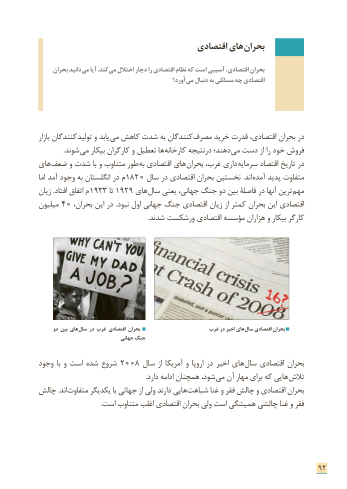

# PDF page 100

اقتصادی های بحران

     بحران دانید می آیا .کند می اختالل دچار را اقتصادی نظام که است آسیبی اقتصادی، بحران
                                                 آورد؟ می دنبال به مسائلی چه اقتصادی

بازار کنندگان تولید و یابد می کاهش شدت به کنندگان مصرف خرید قدرت اقتصادی، بحران در
                .شوند می بیکار کارگران و تعطیل ها کارخانه درنتیجه دهند؛ می دست از را خود فروش
های ضعف و شدت با و متناوب طور به اقتصادی های بحران غرب، داری سرمایه اقتصاد تاریخ در
اما آمد وجود به انگلستان در م 1820 سال در اقتصادی بحران نخستین .اند آمده پدید متفاوت
زیان .افتاد اتفاق م 1933 تا 1929 های سال یعنی جهانی، جنگ دو بین فاصلۀ در آنها ترین مهم
میلیون  40 ،اقتصادیبحران این در .نبود اول جهانی جنگ اقتصادی زیان از کمتر بحران این
                                                                     .شدند ورشکست اقتصادی مؤسسه هزاران و بیکار کارگر

      دو بین های سال در غرب اقتصادی بحران                     غرب در اخیر های سال اقتصادی بحران
                                جهانی جنگ

وجود  با و است شده شروع 2008 سال از آمریکا و اروپا در اخیر های سال اقتصادی بحران
   . دارد ادامه همچنان شود، می آن مهار برای که هایی تالش
چالش .اند متفاوت یکدیگر با جهاتی از ولی دارند هایی شباهت غنا و فقر چالش و اقتصادی بحران
                                       .است متناوب اغلب اقتصادی بحران ولی است همیشگی چالشی غنا و فقر

                                                                      92

