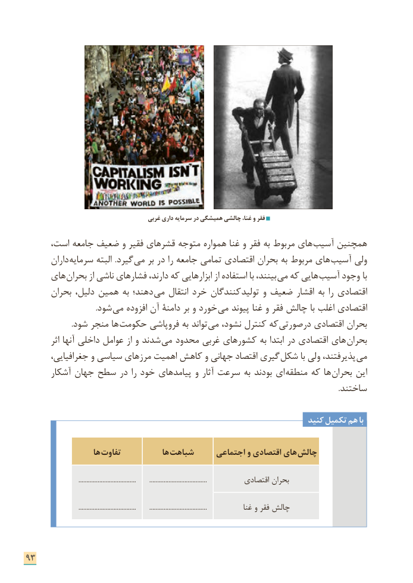

# PDF page 101

غربی داری سرمایه در همیشگی چالشی غنا، و فقر

،هایاست جامعه ضعیف و فقیر قشرهای متوجه همواره غنا و فقر به مربوط       آسیب همچنین
       داران سرمایه البته  .گیرد  می بر در را جامعه تمامی اقتصادی بحران به مربوط های آسیب ولی
     های  بحران از ناشی فشارهای دارند، که ابزارهایی از استفاده با بینند،  می که هایی  آسیب وجود با
      بحران دلیل، همین به دهند؛ می انتقال خرد کنندگان  تولید و ضعیف اقشار به را اقتصادی
       . شود می افزوده آن دامنۀ بر و خورد می پیوند غنا و فقر چالش با اغلب اقتصادی
  . شود منجر ها حکومت فروپاشی به تواند می نشود، کنترل که  درصورتی اقتصادی بحران
         اثر آنها داخلی عوامل از و شدند  می محدود غربی کشورهای به ابتدا در اقتصادی های بحران
       جغرافیایی، و سیاسی مرزهای اهمیت کاهش و جهانی اقتصاد گیری  شکل با ولی پذیرفتند،  می
      آشکار جهان سطح در را خود پیامدهای و آثار سرعت به بودند ای منطقه که ها بحران این
                                                                                                                                                                     .ساختند

                                                                      کنید تکمیل هم با

                   ها تفاوت            ها  شباهت     اجتماعی و اقتصادی های  چالش

                                 ....................................        ....................................          اقتصادی بحران

                                 ....................................        ....................................             غنا و فقر چالش

93

