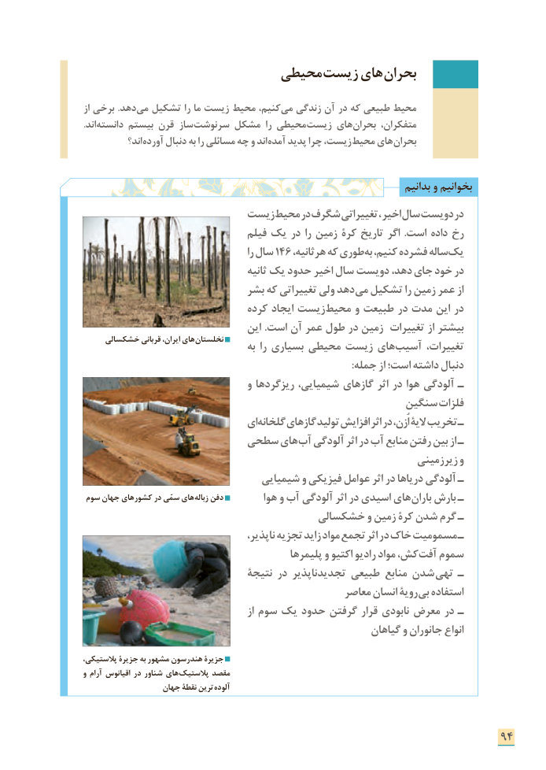

# PDF page 102

محیطی زیست های بحران

از برخی .دهد می تشکیل را ما زیست محیط کنیم، می زندگی آن در که طبیعی محیط
.اند دانسته بیستم قرن  ساز سرنوشت مشکل را محیطی زیست های بحران متفکران،
            اند؟ آورده دنبال به را مسائلی چه و اند آمده پدید چرا زیست، محیط های بحران

                                                                          بدانیم و بخوانیم
                        زیست محیط در شگرف تغییراتی ، اخیر سال دویست در
                                 فیلم یک در را زمین کرۀ تاریخ اگر .است داده رخ
                                               را سال 146 ،طوریهرثانیه که          به کنیم، فشرده ساله یک
                                         ثانیه یک حدود اخیر سال دویست دهد، جای خود در
                            بشر که تغییراتی ولی دهد می تشکیل را زمین عمر از
                                کرده ایجاد زیست محیط و طبیعت در مدت این در
                                  این .است آن عمر طول در زمین تغییرات از بیشتر
     خشکسالی قربانی ایران، های نخلستان                                      به را بسیاری محیطی زیست های آسیب تغییرات،
                                                                                                       :جمله از است؛ داشته دنبال
                                 و ریزگردها شیمیایی، گازهای اثر در هوا آلودگی ـ
                                                  سنگین فلزات
                               ای گلخانه گازهای تولید افزایش اثر در اُزن، الیۀ تخریب ـ
                     سطحی های آب آلودگی اثر در آب منابع رفتن بین از ـ
                                                                 زیرزمینی و
                                شیمیایی و فیزیکی عوامل اثر در دریاها آلودگی ـ
 سوم جهان کشورهای در سمّی های زباله دفن         هوا و آب آلودگی اثر در اسیدی های باران بارش ـ
                                   خشکسالی و زمین کرۀ شدن گرم ـ
                                         ناپذیر، تجزیه زاید مواد تجمع اثر در خاک مسمومیت ـ
                                            پلیمرها و اکتیو رادیو مواد کش، آفت سموم
                                نتیجۀ در تجدیدناپذیر طبیعی منابع شدن تهی ـ
                                                 معاصر انسان رویة بی استفاده
                                              از سوم یک حدود گرفتن قرار نابودی معرض در ـ
                                                          گیاهان و جانوران انواع

،پالستیکی جزیرة به مشهور هندرسون جزیرة
و آرام اقیانوس در شناور های پالستیک مقصد
                  جهان نقطۀ ترین آلوده

                                                                   94

