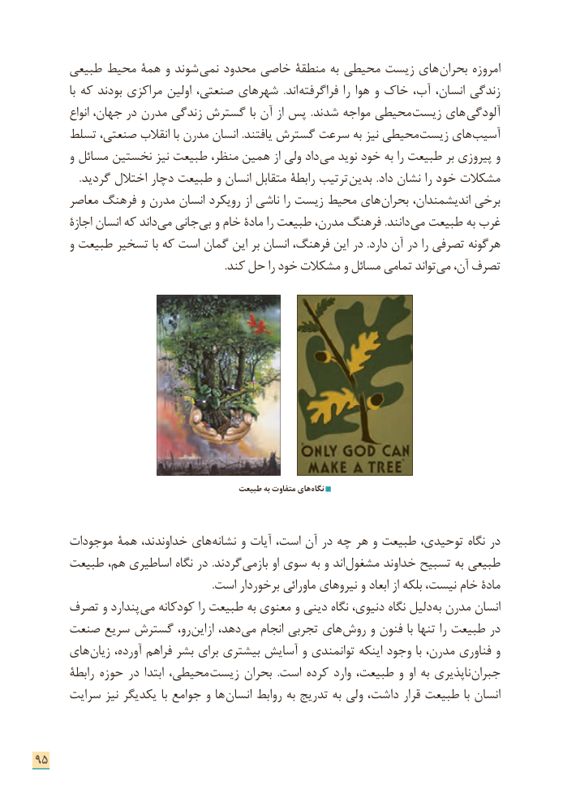

# PDF page 103

طبیعی محیط همۀ و شوند نمی محدود خاصی منطقۀ به محیطی زیست های  بحران امروزه
           با که بودند مراکزی اولین صنعتی، شهرهای  .اند فراگرفته را هوا و خاک آب، انسان، زندگی
         انواع جهان، در مدرن زندگی گسترش با آن از پس  .شدند مواجه محیطی  زیست های آلودگی
     تسلط صنعتی، انقالب با مدرن انسان .یافتند گسترش سرعت به نیز محیطی زیست های آسیب
       و مسائل نخستین نیز طبیعت منظر، همین از ولی داد می نوید خود به را طبیعت بر پیروزی و
                 .گردید اختالل دچار طبیعت و انسان متقابل رابطۀ ترتیب بدین .داد نشان را خود مشکالت
      معاصر فرهنگ و مدرن انسان رویکرد از ناشی را زیست محیط های بحران اندیشمندان، برخی
       اجازۀ انسان که داند می جانی بی و خام مادۀ را طبیعت مدرن، فرهنگ .دانند می طبیعت به غرب
       و طبیعت تسخیر با که است گمان این بر انسان فرهنگ، این در .دارد آن در را تصرفی هرگونه
  . کند حل را خود مشکالت و مسائل تمامی تواند می آن، تصرف

                                            طبیعت به متفاوت های نگاه

     موجودات همۀ ند، خداوند های نشانه و آیات است، آن در چه هر و طبیعت توحیدی، نگاه در
     طبیعت هم، اساطیری نگاه در .گردند بازمی او سوی به و اند مشغول خداوند تسبیح به طبیعی
                                                                    .است برخوردار ماورائی نیروهای و ابعاد از بلکه نیست، خام مادۀ
     تصرف و پندارد می کودکانه را طبیعت به معنوی و دینی نگاه دنیوی، نگاه دلیل به مدرن انسان
    صنعت سریع گسترش رو، این از دهد، می انجام تجربی های روش و فنون با تنها را طبیعت در
     های زیان آورده، فراهم بشر برای بیشتری آسایش و توانمندی اینکه وجود با مدرن، فناوری و
       رابطۀ حوزه در ابتدا محیطی،  زیست بحران  .است کرده وارد طبیعت، و او به ناپذیری جبران
     سرایت نیز یکدیگر با جوامع و ها انسان روابط به تدریج به ولی داشت، قرار طبیعت با انسان

95

