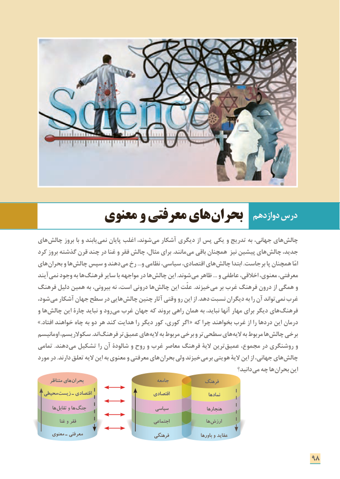

# PDF page 106

دوازدهم درس          معنوی و معرفتی های بحران

های چالش بروز با و یابند نمی پایان اغلب شوند، می آشکار دیگری از پس یکی و تدریج به جهانی، های چالش
کرد بروز گذشته قرن چند در غنا و فقر چالش مثال، برای .مانند می باقی همچنان نیز پیشین های چالش جدید،
های بحران و ها چالش سپس و دهند می رخ ...و نظامی سیاسی، اقتصادی، های چالش ابتدا .جاست بر  پا همچنان امّا
آیند نمی وجود به ها فرهنگ سایر با مواجهه در ها چالش این .شوند ...می ظاهر    و عاطفی اخالقی، معنوی، معرفتی،
فرهنگ دلیل همین به بیرونی، نه است، درونی ها چالش این علّت .خیزند می بر غرب فرهنگ درون از همگی و
شود، می آشکار جهان سطح در هایی چالش چنین آثار وقتی  رو این از .دهد نسبت دیگران به را آن تواند نمی غرب
و ها چالش این چارۀ نباید و رود می غرب جهان که بروند راهی همان به نباید، آنها مهار برای دیگر های فرهنگ
.»افتاد خواهند چاه به دو هر کند هدایت را دیگر کور کوری، اگر  « که چرا بخواهند غرب از را دردها این درمان
اومانیسم سکوالریسم، .اند فرهنگ تر عمیق های الیه به مربوط برخی و تر سطحی های الیه به مربوط ها چالش برخی
تمامی .دهند می تشکیل را آن شالودۀ و روح و غرب معاصر فرهنگ الیۀ ترین عمیق مجموع، در روشنگری و
مورد در .دارند تعلق الیه این به معنوی و معرفتی های بحران ولی خیزند می بر هویتی الیۀ این از جهانی، های چالش
                                                                                دانید؟ می چه ها بحران این
      متناظر های بحران                               جامعه            فرهنگ
  محیطی زیست ـ اقتصادی                          اقتصادی                   نمادها
       ها تقابل و ها جنگ                         سیاسی                 هنجارها
            غنا و فقر                                 اجتماعی                 ها ارزش
      معنوی ـ معرفتی                            فرهنگی                باورها و عقاید

                                                                      98

