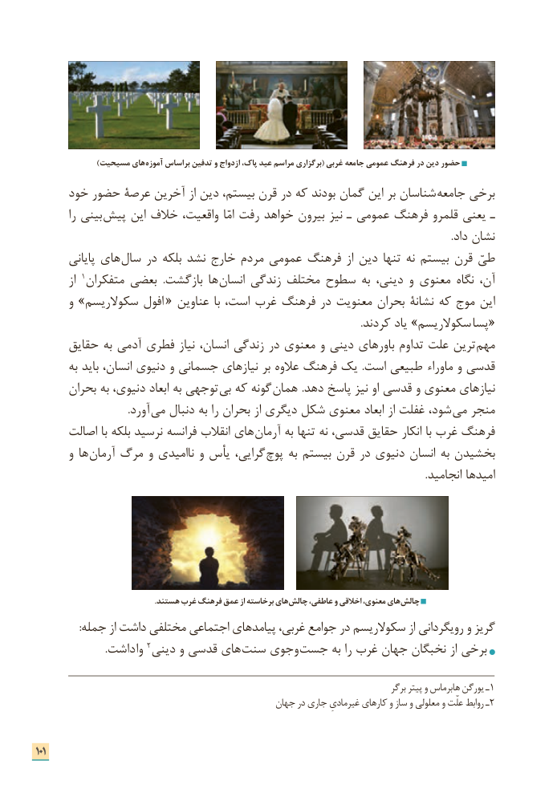

# PDF page 109

)مسیحیت های آموزه براساس تدفین و ازدواج پاک، عید مراسم برگزاری( غربی جامعه عمومی فرهنگ در دین حضور
     خود حضور عرصۀ آخرین از دین بیستم، قرن در که بودند گمان این بر شناسان  جامعه برخی
         را بینی پیش این خالف واقعیت،  امّا رفت خواهد بیرون نیز ـ عمومی فرهنگ قلمرو یعنی ـ
                                                                                                                                                                   .داد نشان
        پایانی های  سال در بلکه نشد خارج مردم عمومی فرهنگ از دین تنها نه بیستم قرن طیّ
         از 1متفکران بعضی  .بازگشت ها  انسان زندگی مختلف سطوح به دینی، و معنوی نگاه آن،
       و »سکوالریسم افول  « عناوین  با است، غرب فرهنگ در معنویت بحران نشانۀ که موج این
       . «کردند یاد »سکوالریسم پسا
      حقایق به آدمی فطری نیاز انسان، زندگی در معنوی و دینی باورهای تداوم علت ترین مهم
       به باید انسان، دنیوی و جسمانی نیازهای بر عالوه فرهنگ یک  .است طبیعی   ماوراء و قدسی
      بحران به دنیوی، ابعاد به توجهی بی که گونه همان .دهد پاسخ نیز او قدسی و معنوی نیازهای
       . آورد می دنبال به را بحران از دیگری شکل معنوی ابعاد از غفلت شود، می منجر
      اصالت با بلکه نرسید فرانسه انقالب های آرمان به تنها نه قدسی، حقایق انکار با غرب فرهنگ
       و ها  آرمان مرگ و ناامیدی و یأس گرایی،  پوچ به بیستم قرن در دنیوی انسان به بخشیدن
                                                                                                                                                         .انجامید امیدها

                                                              .هستند غرب فرهنگ عمق از برخاسته های چالش عاطفی، و اخالقی معنوی، های چالش
                 :جمله از داشت مختلفی اجتماعی پیامدهای غربی، جوامع در سکوالریسم از رویگردانی و گریز
    . داشت وا 2دینی و قدسی های سنت وجوی جست به را غرب جهان نخبگان از برخی

                                                                                              برگر پیتر و هابرماس یورگن ـ 1
                                                جهان در جاری غیرمادیِ کارهای و ساز و معلولی و علّت روابط ـ2

101

