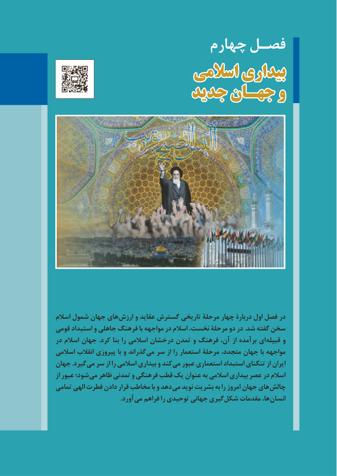

# PDF page 113

چهارم فصـل
                       اسالمیاسالمی بیداریبیداری
                    جدیدجدید جهـانجهـان وو

            اسالم شمول جهان های ارزش و عقاید گسترش تاریخی مرحلة چهار دربارة اول فصل در
          قومی استبداد و جاهلی فرهنگ با مواجهه در اسالم نخست، مرحلۀ دو در .شد گفته سخن
           در اسالم جهان .کرد بنا را اسالمی درخشان تمدن و فرهنگ آن، از برآمده ای قبیله و
           اسالمی انقالب پیروزی با و گذراند می سر از را استعمار مرحلة متجدد، جهان با مواجهه
          جهان .گیرد می سر از را اسالمی بیداری و کند می عبور استعماری استبداد تنگنای از ایران
                از عبور شود؛ می ظاهر تمدنی و فرهنگی قطب یک عنوان به اسالمی بیداری عصر در اسالم
           تمامی الهی فطرت دادن قرار مخاطب با و دهد می نوید بشریت به را امروز جهان های چالش
             . آورد می فراهم را توحیدی جهانی گیری شکل مقدمات ها، انسان

105

