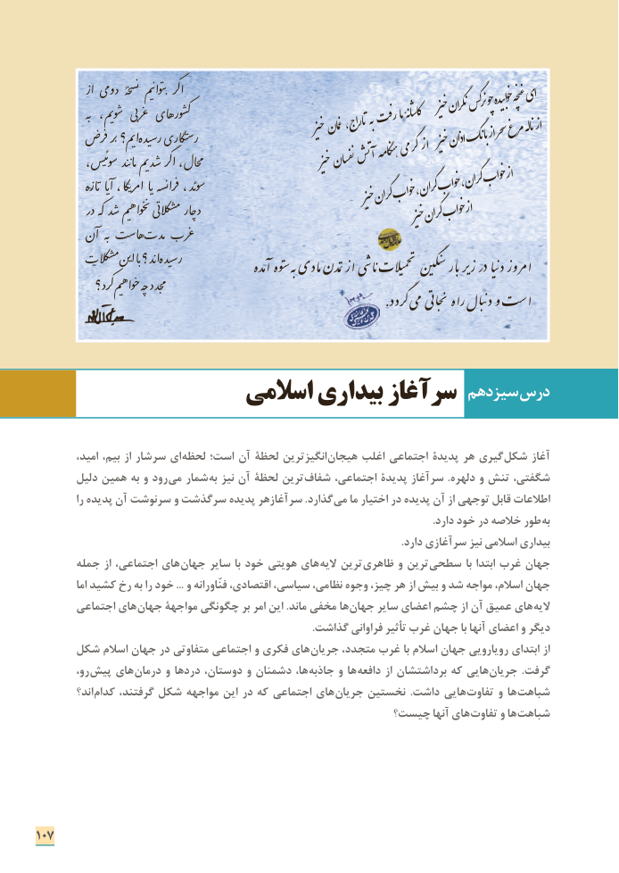

# PDF page 115

ô˟ا دومی      خۀٌ نسŮ  یمʿŪتواʹŪ  گرȿا                              بهŷ  یم،ŵوƫ  بیźغرȃ هایرو˵ɀ                                       خیزننگرارنگسچوخوابیدهغنچهای                                                  هبرفتماکاشاهنٔ                              ŵ                                           ȡ                      س                                                             ˋ                   خیزغماناتراج،   ö                       فر                          بر                                                           ŭ یم؟                             ا یدهر             یرس                                ʲ                            تگار                                                                            سحرمرغانهلاز                                                                خیزاذانبانگاز                                          Ũ                        ʸ                                                                  ȿ    ،ویسس                           یمŵ                    Ƥ گر                                       ا                             محال،            د                       ندʲŪما                                    آتشهنگاهمگرمیاز                                             خیزنفسان                                                                                      ȡ                              یا      ،نسهیکا                                                                                                         Ɓامر                                                 یاŨ                                                                                          Ůفرا                 ،و             Ũ�       ه                            ئدس           ôتاŨ                                                                     گران، خواباز                                                              گران،خواب                                     م                                                                                              Ũ                          خیزگرانخواب            رد                                      کهɉ             Ƥ                         یمʿ                               خواه˗Ŭ          تیردźکال                        ا                                  Ɔ        د                                                            خیزگرانخواباز    ن�    بهŷĭهاس ñȃمدñغر
                     م ینŶا باŨ ند؟ ا یدهرʲس    ñŨکال                                                    θː س                                                                                          حمƊ                           ن˞                                                                                                                                       بارƆ یرƋý رد یاːƈدýامرو                                     مدهð توه˜ س بهƕ مادی تمدنƝýا یǔاƆ ôیالː              کرد؟ȿ یمʿخواهƍ چهƕ جدد�م                                                                                                                                                            .ردد ɝ می تی Ƙجاˮ Ɗ راه بالːƈد وŋ اس

                                                  سیزدهم درس                  اسالمی بیداری سرآغاز

 ،ایامید بیم، از سرشار      لحظه است؛ آن لحظة انگیزترین هیجان اغلب اجتماعی پدیدۀ هر گیری شكل آغاز
        دلیل همین به و رود می شمار به نیز آن لحظة ترین شفاف اجتماعی، پدیدة سرآغاز .دلهره و تنش شگفتی،
           را پدیده آن سرنوشت و سرگذشت پدیده سرآغازهر .گذارد می ما اختیار در پدیده آن از توجهی قابل اطالعات
       . دارد خود در خالصه طور به
                                                                                                                                        .دارد سرآغازی نیز اسالمی بیداری
       جمله از اجتماعی، های جهان سایر با خود هویتی های الیه ترین ظاهری و ترین سطحی با ابتدا غرب جهان
           اما كشید رخ به را خود ... و فنّاورانه اقتصادی، سیاسی، نظامی، وجوه چیز، هر از بیش و شد مواجه اسالم، جهان
       اجتماعی های جهان مواجهۀ چگونگی بر امر این .ماند مخفی ها جهان سایر اعضای چشم از آن عمیق های الیه
                                                                                                       .گذاشت فراوانی تأثیر غرب جهان با آنها اعضای و دیگر
     شكل اسالم جهان در متفاوتی اجتماعی و فكری های جریان متجدد، غرب با اسالم جهان رویارویی ابتدای از
         رو، پیش های درمان و دردها دوستان، و دشمنان ها، جاذبه و ها دافعه از برداشتشان كه هایی جریان .گرفت
         اند؟ کدام گرفتند، شکل مواجهه این در که اجتماعی های جریان نخستین  .داشت هایی تفاوت و ها شباهت
                                                چیست؟ آنها های تفاوت و ها شباهت

107

