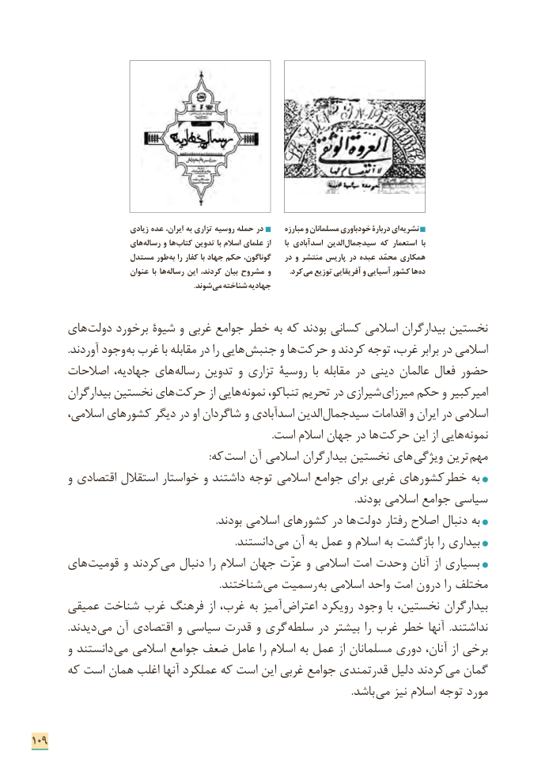

# PDF page 117

زیادی عده ایران، به تزاری روسیه حمله در       مبارزه و مسلمانان خودباوری دربارۀ ای نشریه
                       های رساله و ها کتاب تدوین با اسالم علمای از      با اسدآبادی الدین سیدجمال که استعمار  با
                    مستدل طور به را کفار با جهاد حکم گوناگون،    در و منتشر پاریس در عبده محمّد همکاری
                          عنوان با ها رساله این کردند، بیان مشروح و  . کرد می توزیع آفریقایی و آسیایی کشور ها ده
                . شوند می شناخته جهادیه

      های دولت برخورد شیوۀ و غربی جوامع خطر به که بودند کسانی اسالمی بیدارگران نخستین
 . آوردند وجود به غرب با مقابله در را هایی جنبش و ها حرکت و کردند توجه غرب، برابر در اسالمی
      اصالحات جهادیه، های رساله تدوین و تزاری روسیۀ  با مقابله در دینی عالمان فعال حضور
        بیدارگران نخستین های حرکت از هایی نمونه تنباکو، تحریم در شیرازی میرزای حکم و امیرکبیر
       اسالمی، کشورهای دیگر در او شاگردان و اسدآبادی الدین سیدجمال اقدامات و ایران در اسالمی
    . است اسالم جهان در ها حرکت این از هایی نمونه
                   : که است آن اسالمی بیدارگران نخستین های  ویژگی ترین  مهم
       و اقتصادی استقالل خواستار و داشتند توجه اسالمی جوامع برای غربی کشورهای خطر به
                                                                                                                                .بودند اسالمی جوامع سیاسی
   . بودند اسالمی کشورهای در ها دولت رفتار اصالح دنبال به
                                                                                 .دانستند می آن به عمل و اسالم به بازگشت را بیداری
      های قومیت و کردند می دنبال را اسالم جهان عزّت و اسالمی امت وحدت آنان از بسیاری
                                                                           .شناختند می رسمیت به اسالمی واحد امت درون را مختلف
      عمیقی شناخت غرب فرهنگ از غرب، به آمیز  اعتراض رویکرد وجود با نخستین، بیدارگران
              .دیدند می آن اقتصادی و سیاسی قدرت و گری  سلطه در بیشتر را غرب خطر آنها  .نداشتند
       و دانستند می اسالمی جوامع ضعف عامل را اسالم به عمل از مسلمانان دوری آنان، از برخی
      که است همان اغلب آنها عملکرد که است این غربی جوامع قدرتمندی دلیل کردند می گمان
                       . باشد می نیز اسالم توجه مورد

109

